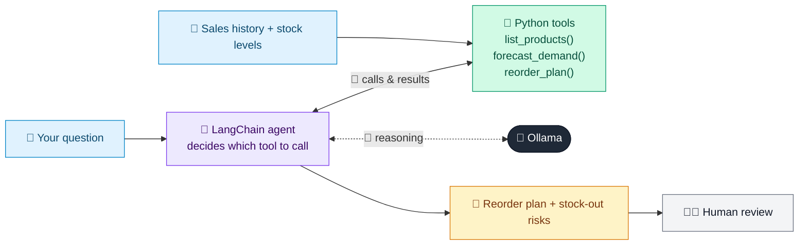

# 01 · Demand Forecasting & Replenishment Agent

  

**Industry:** 🛒 Retail · **Category:** 📦 Supply Chain & Inventory

## 🛒 The business problem (new to retail? start here)

**In the business today:** Every week, replenishment analysts decide how much of each product to order from suppliers, based on recent sales, trends and upcoming promotions.

**Who does this work:** Replenishment / inventory analysts in the supply chain team.

**Why it's hard:** Large retailers manage tens of thousands of products. Seasonal products (sunscreen in summer, scarves in winter) change fast, and both empty shelves and overstock cost money.

### Key terms
- **Demand forecasting**: Predicting how many units will sell in future weeks, using past sales, trends, seasons and promotions.
- **Replenishment**: Re-ordering stock from suppliers so shelves don't run empty.
- **Lead time**: How long a supplier takes to deliver after an order is placed.
- **Weeks of cover**: How many weeks current stock will last at forecast sales.
- **Safety stock**: Extra stock held to protect against forecast errors and late deliveries.
- **Reorder point**: The stock level at which a new order must be placed to arrive before running out.
- **Stock-out**: When a product is unavailable: a lost sale and an unhappy customer.
- **Promotion uplift**: The extra sales a promotion generates over normal demand.

More terms: [Retail Primer & glossary](../PRIMER.md#glossary)

---

## 🤖 What the AI does
Forecasts weekly demand per product and recommends what to reorder, flagging stock-out risks.

### How it works
Tools compute trend-based forecasts with promotion uplift, weeks of cover, safety stock and order quantities in full cases; the agent explains priorities and actions for slow sellers.



<sub>🟦 data · 🟩 Python: maths & rules (auditable) · 🟪 AI: reasoning & writing · ⬛ local LLM · 🟨 result</sub>

## 💬 Sample conversation

A real recorded run on `qwen2.5:7b-instruct` (local, on a laptop, 13 s). Expand a step to see what happened
behind the answer. LLM wording changes from run to run; the numbers from Python stay the same.

> **👤 You:** Review all products: what should we reorder this week and why?

<details><summary>🔧 Tool calls</summary>

```text
list_products() -> {"SKU-101": "Organic oat milk 1L", "SKU-102": "Sunscreen SPF50 200ml", "SKU-103": "Wool scarf (grey)"}
forecast_demand(sku='SKU-101') -> {"sku": "SKU-101", "trend_units_per_week": 8.3, "weekly_forecast": [478, 486, 494, 503], "promo_next_week": false}
forecast_demand(sku='SKU-102') -> {"sku": "SKU-102", "trend_units_per_week": 28.3, "weekly_forecast": [394, 320, 349, 377], "promo_next_week": true}
forecast_demand(sku='SKU-103') -> {"sku": "SKU-103", "trend_units_per_week": -5.0, "weekly_forecast": [9, 4, 0, 0], "promo_next_week": false}
reorder_plan(sku='SKU-101') -> {"sku": "SKU-101", "available_units": 900, "weeks_of_cover": "1.9", "lead_time_weeks": 1, "reorder_point": 521, "order_now": false, "recommended_order_units": 0, "stockout_risk_before_delivery": false, "demand_status": "STEADY"}
reorder_plan(sku='SKU-102') -> {"sku": "SKU-102", "available_units": 380, "weeks_of_cover": "1.0", "lead_time_weeks": 2, "reorder_point": 870, "order_now": true, "recommended_order_units": 1224, "stockout_risk_before_delivery": true, "demand_status": "GROWING DEMAND (do not discount)"}
reorder_plan(sku='SKU-103') -> {"sku": "SKU-103", "available_units": 840, "weeks_of_cover": "12+", "lead_time_weeks": 4, "reorder_point": 66, "order_now": false, "recommended_order_units": 0, "stockout_risk_before_delivery": false, "demand_status": "SLOW SELLER / OVERSTOCK (consider markdown or cancelling open orders)"}
```

</details>

**🦙 Ollama:**

Based on the analysis of the products, here is the summary for each SKU:

| SKU | Product                | Weeks of Cover | Order Now? | Order Units | Stock-Out Risk | Trends & Promotions | Actions for Slow Sellers |
|-----|------------------------|----------------|------------|-------------|----------------|---------------------|-------------------------|
| SKU-101 | Organic oat milk 1L    | 1.9            | No         | 0           | No             | Steady demand       | None                    |
| SKU-102 | Sunscreen SPF50 200ml  | 1.0            | Yes        | 1224        | Yes            | Growing demand (no promotion) | None                    |
| SKU-103 | Wool scarf (grey)      | 12+            | No         | 0           | No             | Slow seller / overstock | Consider markdown or cancelling open orders |

### Summary:
- **SKU-101 (Organic oat milk 1L)**: The product has a steady demand with 1.9 weeks of cover. No immediate action is required.
- **SKU-102 (Sunscreen SPF50 200ml)**: There is a stock-out risk before delivery, and the demand is growing. We should place an order now to avoid stockouts.
- **SKU-103 (Wool scarf (grey))**: The product is a slow seller with 12+ weeks of cover. Consider markdown or cancelling open orders to reduce overstock.

These recommendations are based on the current demand trends and stock levels. Adjustments may be necessary as new data becomes available.


## Run
```bash
# from the repo root, with Ollama running
python 02_retail/01_demand_forecasting_agent/app.py
```

## Customize
- Replace the sample data at the top of `app.py` with your own data source (CSV, database, API).
- Tune thresholds and rules in the Python functions. These are the auditable part of the solution.
- Change the model with `OLLAMA_MODEL` (see the root [README](../../README.md#-model-recommendations)).

> Sample data is fictional; calculations are simplified for learning.

[⬅ Back to Retail use cases](../README.md#-use-cases) · [All industries](../../README.md)
