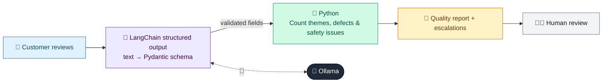

# 02 · Product Review Analyzer

  

**Industry:** 🛒 Retail · **Category:** 🙋 Customer Insight

## 🛒 The business problem (new to retail? start here)

**In the business today:** Product and quality teams read customer reviews to spot recurring problems, fix product listings and catch safety issues early.

**Who does this work:** Product managers, quality assurance and customer care teams.

**Why it's hard:** Popular products get thousands of reviews. Important signals, like a burning smell or a cracked blade, can be buried among comments about delivery or colour.

### Key terms
- **Customer reviews / sentiment**: Star ratings and comments; sentiment is whether they are positive, neutral or negative.
- **Product defect**: A fault in the product itself (leaks, breakage), as opposed to a matter of taste.
- **Product recall**: Withdrawing an unsafe product from sale and from customers. Safety complaints must be escalated fast.

More terms: [Retail Primer & glossary](../PRIMER.md#glossary)

---

## 🤖 What the AI does
Turns customer reviews into sentiment, complaint themes, defects and safety issues.

### How it works
Each review is classified into a Pydantic schema, Python aggregates the counts, and an LLM chain writes the quality report with escalation of safety concerns.



<sub>🟦 data · 🟩 Python: maths & rules (auditable) · 🟪 AI: reasoning & writing · ⬛ local LLM · 🟨 result</sub>

## 💬 Sample response

Real output from `qwen2.5:7b-instruct` running locally on a laptop. LLM wording changes from run to run; the numbers from
Python stay the same.

<details>
<summary><b>Show the full output</b></summary>

````text
--- 5★ Makes smoothies in 30 seconds and is easy to clean. Love it! ---
{'sentiment': 'positive', 'themes': ['performance', 'cleaning', 'size'], 'product_defect': False, 'safety_concern': False}


--- 2★ Lid started leaking after two weeks. Juice everywhere on my  ---
{'sentiment': 'negative', 'themes': ['leaking', 'size'], 'product_defect': True, 'safety_concern': False}


--- 4★ Powerful for the size, but quite loud early in the morning. ---
{'sentiment': 'positive', 'themes': ['performance', 'noise'], 'product_defect': True, 'safety_concern': False}


--- 1★ Motor burned out after a month. Smelled of burning plastic.  ---
{'sentiment': 'negative', 'themes': ['performance', 'size', 'durability'], 'product_defect': True, 'safety_concern': True}


--- 3★ Does the job but the cup is smaller than the photos suggest. ---
{'sentiment': 'neutral', 'themes': ['size', 'size'], 'product_defect': True, 'safety_concern': False}


--- 2★ Leaks from the bottom seal every time I blend ice. ---
{'sentiment': 'negative', 'themes': ['leaking', 'performance'], 'product_defect': True, 'safety_concern': False}


--- 5★ Great value, delivery was fast and it crushes ice well. ---
{'sentiment': 'positive', 'themes': ['value', 'delivery', 'performance'], 'product_defect': False, 'safety_concern': False}


--- 1★ Blade assembly cracked; I'm worried about plastic bits in my ---
{'sentiment': 'negative', 'themes': ['durability', 'size', 'size'], 'product_defect': True, 'safety_concern': True}


--- Summary ---
{
  "product": "AeroBlend 600W Personal Blender",
  "reviews": 8,
  "avg_stars": 2.88,
  "sentiment": {
    "positive": 3,
    "negative": 4,
    "neutral": 1
  },
  "theme_counts": {
    "size": 7,
    "performance": 5,
    "leaking": 2,
    "durability": 2,
    "cleaning": 1,
    "noise": 1,
    "value": 1,
    "delivery": 1
  },
  "defect_reviews": 6,
  "safety_reviews": [
    "Motor burned out after a month. Smelled of burning plastic. Very disappointed.",
    "Blade assembly cracked; I'm worried about plastic bits in my drink."
  ]
}


--- Quality report ---
**AeroBlend 600W Personal Blender Quality Analysis Report**

**Overall Sentiment:**
- Positive: 37.5%
- Negative: 50%
- Neutral: 12.5%

**Top Complaint Themes:**
1. **Size** - 87.5% (7 out of 8 reviews)
2. **Performance** - 62.5% (5 out of 8 reviews)
3. **Leaking** - 25% (2 out of 8 reviews)
4. **Durability** - 25% (2 out of 8 reviews)
5. **Cleaning** - 12.5% (1 out of 8 reviews)
6. **Noise** - 12.5% (1 out of 8 reviews)
7. **Value** - 12.5% (1 out of 8 reviews)
8. **Delivery** - 12.5% (1 out of 8 reviews)

**Safety Issues:**
- **Motor burned out after a month. Smelled of burning plastic. Very disappointed.**
- **Blade assembly cracked; I'm worried about plastic bits in my drink.**

**Urgent Actions:**
1. **Supplier Quality Check:** Conduct a thorough quality inspection of the AeroBlend 600W Personal Blender with the supplier to identify and address the root causes of the durability and safety issues.
2. **Listing Description Fix:** Update the product listing to include clear warnings about potential safety hazards, such as the risk of burning plastic and cracked blade assemblies, and provide detailed instructions on proper usage and maintenance.
3. **Customer Replies:** Respond promptly to all negative reviews, especially those related to safety concerns, offering solutions such as free repairs or replacements, and assure customers of the steps being taken to improve product quality.

**Next Steps:**
- Review the safety issues with the quality assurance team to determine if a product recall is necessary.
- Implement the above actions to mitigate customer dissatisfaction and improve product safety and quality.
````

</details>

## Run
```bash
# from the repo root, with Ollama running
python 02_retail/02_product_review_analyzer/app.py
```

## Customize
- Replace the sample data at the top of `app.py` with your own data source (CSV, database, API).
- Tune thresholds and rules in the Python functions. These are the auditable part of the solution.
- Change the model with `OLLAMA_MODEL` (see the root [README](../../README.md#-model-recommendations)).

> Sample data is fictional; calculations are simplified for learning.

[⬅ Back to Retail use cases](../README.md#-use-cases) · [All industries](../../README.md)
