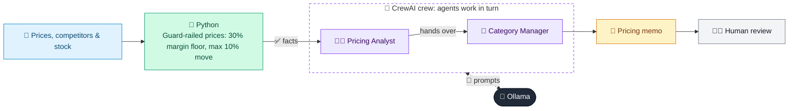

# 03 · Dynamic Pricing Advisor

  

**Industry:** 🛒 Retail · **Category:** 🏷️ Merchandising & Pricing

## 🛒 The business problem (new to retail? start here)

**In the business today:** Pricing teams regularly review prices against competitors and stock levels: raise prices where there is room, cut to clear overstock, and protect margin.

**Who does this work:** Pricing analysts and category managers.

**Why it's hard:** Every price change trades volume against margin, and customers notice price swings. Decisions must respect margin rules and be explainable.

### Key terms
- **Gross margin**: (Price - cost) / price. A 30% margin means 30p of every 1 of sales is left after paying for the product.
- **Price elasticity**: How much volume changes when price changes. Elasticity of -2 means a 1% price cut lifts volume about 2%.
- **Competitive price index**: Our price compared to competitors' average for the same product.
- **Markdown**: A permanent price cut, usually to clear excess or seasonal stock.
- **Category manager**: The person who owns a product category's range, pricing and profit.

More terms: [Retail Primer & glossary](../PRIMER.md#glossary)

---

## 🤖 What the AI does
Recommends price changes from competitor prices, stock levels and elasticity, within margin guardrails.

### How it works
Python proposes prices (30% margin floor, max 10% move) and estimates profit impact; a Pricing Analyst agent explains them and a Category Manager agent approves or adjusts and writes the pricing memo.



<sub>🟦 data · 🟩 Python: maths & rules (auditable) · 🟪 AI: reasoning & writing · ⬛ local LLM · 🟨 result</sub>

## 💬 Sample conversation

A real recorded run on `qwen2.5:7b-instruct` (local, on a laptop, 34 s). Expand a step to see what happened
behind the answer. LLM wording changes from run to run; the numbers from Python stay the same.

> **👤 You:** Should we change prices on our earbuds, water bottles and other lines this week?

<details><summary>🐍 Python · Guard-railed price proposals</summary>

```json
[
  {
    "sku": "P-1",
    "name": "Wireless earbuds",
    "current_price": 49.99,
    "competitor_avg": 45.5,
    "proposed_price": 49.99,
    "change_pct": 0.0,
    "margin_pct": 58.0,
    "expected_weekly_units": 320,
    "weekly_gross_profit_now": 9277,
    "weekly_gross_profit_new": 9277,
    "weeks_of_stock": 3.0,
    "pricing_reason": "Low stock (3.0 weeks): hold price even though it is +9.9% vs competitors, to avoid selling out"
  },
  {
    "sku": "P-2",
    "name": "Stainless water bottle 750ml",
    "current_price": 14.99,
    "competitor_avg": 17.83,
    "proposed_price": 16.49,
    "change_pct": 10.0,
    "margin_pct": 62.4,
    "expected_weekly_units": 481,
    "weekly_gross_profit_now": 4747,
    "weekly_gross_profit_new": 4945,
    "weeks_of_stock": 6.0,
    "pricing_reason": "Move toward competitor average (-15.9% vs competitors); capped at the 10% max move"
  },
  {
    "sku": "P-3",
    "name": "Fleece throw blanket",
    "current_price": 29.99,
    "competitor_avg": 29.5,
    "proposed_price": 28.02,
    "change_pct": -6.6,
    "margin_pct": 66.1,
    "expected_weekly_units": 97,
    "weekly_gross_profit_now": 1742,
    "weekly_gross_profit_new": 1802,
    "weeks_of_stock": 22.0,
    "pricing_reason": "Overstock (22.0 weeks of stock): cut to clear"
  }
]
```

</details>

<details><summary>🧑‍💼 Pricing Analyst (agent)</summary>

### SKU P-1: Wireless Earbuds

**Rationale:**
- **Pricing Reason:** Low stock (3.0 weeks): hold price even though it is +9.9% vs competitors, to avoid selling out.
- **Current Price:** $49.99
- **Competitor Average:** $45.50
- **Proposed Price:** $49.99
- **Change Pct:** 0.0%
- **Margin Pct:** 58.0%
- **Expected Weekly Units:** 320
- **Weekly Gross Profit Now:** $9,277
- **Weekly Gross Profit New:** $9,277
- **Weeks of Stock:** 3.0

**Risks:**
- **Stock Management Risk:** Holding the price despite the competitor's lower average could lead to a potential stockout if demand increases. This might result in lost sales and customer dissatisfaction.
- **Competitive Risk:** Competitors might lower their prices further, potentially drawing customers away from our product.
- **Customer Perception Risk:** Keeping the price high might make the product seem overpriced compared to competitors, potentially affecting customer perception and sales.

### SKU P-2: Stainless Water Bottle 750ml

**Rationale:**
- **Pricing Reason:** Move toward competitor average (-15.9% vs competitors); capped at the 10% max move.
- **Current Price:** $14.99
- **Competitor Average:** $17.83
- **Proposed Price:** $16.49
- **Change Pct:** 10.0%
- **Margin Pct:** 62.4%
- **Expected Weekly Units:** 481
- **Weekly Gross Profit Now:** $4,747
- **Weekly Gross Profit New:** $4,945
- **Weeks of Stock:** 6.0

**Risks:**
- **Price Sensitivity Risk:** A 10% increase in price might be perceived as too high by some customers, potentially leading to a decrease in sales.
- **Competitor Response Risk:** Competitors might match or undercut the new price, leading to a price war that could reduce overall profitability.
- **Market Saturation Risk:** If the market is already saturated, the increase in price might not be enough to justify the higher margin, leading to lower sales volumes.

### SKU P-3: Fleece Throw Blanket

**Rationale:**
- **Pricing Reason:** Overstock (22.0 weeks of stock): cut to clear.
- **Current Price:** $29.99
- **Competitor Average:** $29.50
- **Proposed Price:** $28.02
- **Change Pct:** -6.6%
- **Margin Pct:** 66.1%
- **Expected Weekly Units:** 97
- **Weekly Gross Profit Now:** $1,742
- **Weekly Gross Profit New:** $1,802
- **Weeks of Stock:** 22.0

**Risks:**
- **Sales Volume Risk:** Cutting the price significantly might attract more customers, but it could also lead to a decrease in the perceived value of the product, potentially affecting long-term sales.
- **Profitability Risk:** While the margin is high, the lower price might reduce the overall profitability if the sales volume does not increase significantly.
- **Customer Perception Risk:** Customers might perceive the lower price as a sign of poor quality, which could negatively impact brand perception and future sales.

### Summary

- **SKU P-1:** Maintain current price to avoid stockouts, but monitor competitor actions and customer demand.
- **SKU P-2:** Gradual price increase to align with competitors, but be prepared for potential price competition.
- **SKU P-3:** Significant price reduction to clear overstock, but be cautious of the impact on perceived value and long-term sales.

</details>

**🦙 Ollama:**

### Pricing Memo

| SKU | Current Price | Proposed Price | Decision | Reason | Expected Profit Impact | Notes for Marketing and Store Teams |
|-----|--------------|----------------|----------|--------|------------------------|-------------------------------------|
| P-1 | $49.99        | $49.99         | APPROVE  | Low stock (3.0 weeks): hold price even though it is +9.9% vs competitors, to avoid selling out. | No change in weekly gross profit. | Monitor competitor actions and customer demand. |
| P-2 | $14.99        | $16.49         | APPROVE  | Move toward competitor average (-15.9% vs competitors); capped at the 10% max move. | Increase in weekly gross profit by $198. | Be prepared for potential price competition. |
| P-3 | $29.99        | $28.02         | APPROVE  | Overstock (22.0 weeks of stock): cut to clear. | Increase in weekly gross profit by $60. | Cautiously promote the clearance to avoid perceived quality issues. |

**Notes for Marketing and Store Teams:**
- For SKU P-1, ensure that stock levels are closely monitored and consider promotional activities to boost sales if demand increases.
- For SKU P-2, prepare for potential price competition and consider highlighting the quality and features of the product to justify the new price.
- For SKU P-3, emphasize the clearance sale and offer additional value-added promotions to attract customers. Monitor customer feedback to ensure the price reduction does not negatively impact brand perception.

This memo outlines the decisions and reasons for the proposed price changes, along with expected profit impacts and strategic notes for the marketing and store teams.


## Run
```bash
# from the repo root, with Ollama running
python 02_retail/03_dynamic_pricing_advisor/app.py
```

## Customize
- Replace the sample data at the top of `app.py` with your own data source (CSV, database, API).
- Tune thresholds and rules in the Python functions. These are the auditable part of the solution.
- Change the model with `OLLAMA_MODEL` (see the root [README](../../README.md#-model-recommendations)).

> Sample data is fictional; calculations are simplified for learning.

[⬅ Back to Retail use cases](../README.md#-use-cases) · [All industries](../../README.md)
