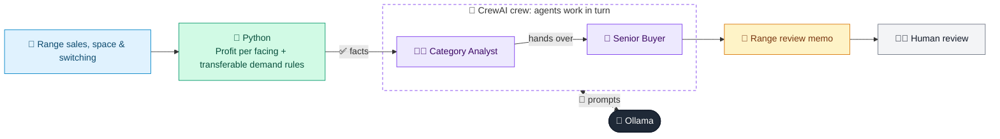

# 05 · Range Review & Assortment Planner

  

**Industry:** 🛒 Retail · **Category:** 🏷️ Merchandising & Pricing

## 🛒 The business problem (new to retail? start here)

**In the business today:** Once or twice a year each category has a range review: buyers decide which products to drop, keep or give more shelf space, and tell the suppliers.

**Who does this work:** Buyers and category managers, supported by category analysts.

**Why it's hard:** Shelf space is limited and every product wants more of it. Dropping a product on sales alone can upset loyal shoppers who have no alternative, while weak products quietly waste space.

### Key terms
- **Range review**: A regular review of which products a category should stock, drop or add.
- **Facing**: One product's width at the front of the shelf. More facings means more space, visibility and stock on display.
- **Transferable demand**: The share of a product's buyers who would buy something else in the range if it were removed.
- **Delist**: To stop stocking a product.
- **Stock-out**: When a product is unavailable: a lost sale and an unhappy customer.
- **Category manager**: The person who owns a product category's range, pricing and profit.

More terms: [Retail Primer & glossary](../PRIMER.md#glossary)

---

## 🤖 What the AI does
Decides which products to delist, keep or give more shelf space in a category range review.

### How it works
Python ranks products on profit per shelf facing and checks how much demand would switch to other products (delist only if 70%+ transfers and no unique need is left unserved); a Category Analyst agent explains the evidence and a Senior Buyer agent writes the range review memo.



<sub>🟦 data · 🟩 Python: maths & rules (auditable) · 🟪 AI: reasoning & writing · ⬛ local LLM · 🟨 result</sub>

## 💬 Sample conversation

A real recorded run on `qwen2.5:7b-instruct` (local, on a laptop, 36 s). Expand a step to see what happened
behind the answer. LLM wording changes from run to run; the numbers from Python stay the same.

> **👤 You:** Which cereals should we delist, keep or give more space in the spring range review?

<details><summary>🐍 Python · Range scorecard</summary>

```json
{
  "category": "Breakfast cereals",
  "products": [
    {
      "sku": "C-01",
      "name": "Honey oat clusters 500g",
      "weekly_sales": 1450,
      "margin_pct": 32,
      "facings": 4,
      "transferable": 0.55,
      "oos_rate": 0.07,
      "unique_need": null,
      "weekly_profit": 464,
      "profit_per_facing": 116,
      "proposal": "ADD A FACING"
    },
    {
      "sku": "C-02",
      "name": "Corn flakes 750g",
      "weekly_sales": 1680,
      "margin_pct": 24,
      "facings": 5,
      "transferable": 0.6,
      "oos_rate": 0.02,
      "unique_need": null,
      "weekly_profit": 403,
      "profit_per_facing": 81,
      "proposal": "KEEP"
    },
    {
      "sku": "C-03",
      "name": "Choco puffs 375g",
      "weekly_sales": 920,
      "margin_pct": 30,
      "facings": 3,
      "transferable": 0.7,
      "oos_rate": 0.01,
      "unique_need": null,
      "weekly_profit": 276,
      "profit_per_facing": 92,
      "proposal": "KEEP"
    },
    {
      "sku": "C-04",
      "name": "Gluten-free granola 400g",
      "weekly_sales": 200,
      "margin_pct": 38,
      "facings": 3,
      "transferable": 0.15,
      "oos_rate": 0.03,
      "unique_need": "gluten-free",
      "weekly_profit": 76,
      "profit_per_facing": 25,
      "proposal": "KEEP (only gluten-free option)"
    },
    {
      "sku": "C-05",
      "name": "Bran flakes 500g",
      "weekly_sales": 310,
      "margin_pct": 26,
      "facings": 3,
      "transferable": 0.85,
      "oos_rate": 0.0,
      "unique_need": null,
      "weekly_profit": 81,
      "profit_per_facing": 27,
      "proposal": "DELIST",
      "profit_kept_by_switching": 69,
      "profit_at_risk": 12
    },
    {
      "sku": "C-06",
      "name": "Fruit muesli 1kg",
      "weekly_sales": 640,
      "margin_pct": 35,
      "facings": 2,
      "transferable": 0.4,
      "oos_rate": 0.09,
      "unique_need": null,
      "weekly_profit": 224,
      "profit_per_facing": 112,
      "proposal": "ADD A FACING"
    },
    {
      "sku": "C-07",
      "name": "Frosted rings 300g",
      "weekly_sales": 240,
      "margin_pct": 28,
      "facings": 3,
      "transferable": 0.8,
      "oos_rate": 0.0,
      "unique_need": null,
      "weekly_profit": 67,
      "profit_per_facing": 22,
      "proposal": "DELIST",
      "profit_kept_by_switching": 54,
      "profit_at_risk": 13
    },
    {
      "sku": "C-08",
      "name": "Protein crunch 350g",
      "weekly_sales": 380,
      "margin_pct": 40,
      "facings": 2,
      "transferable": 0.35,
      "oos_rate": 0.04,
      "unique_need": null,
      "weekly_profit": 152,
      "profit_per_facing": 76,
      "proposal": "KEEP"
    }
  ],
  "facings_freed_by_delists": 6,
  "facings_requested_by_expansions": 2,
  "facings_left_over": 4,
  "weekly_profit_at_risk_from_delists": 25,
  "rules": "DELIST = bottom 3 on profit per facing AND at least 70% of demand transfers AND no unique need; ADD A FACING = out of stock more than 5% of the time"
}
```

</details>

<details><summary>🧑‍💼 Category Analyst (agent)</summary>

Sure, here is the detailed explanation for each product's proposal based on the provided criteria:

1. **SKU C-01 (Honey oat clusters 500g):**
   - **Proposal:** ADD A FACING
   - **Evidence:** Out-of-stock rate is 7%, and profit per facing is $116, which is relatively high, but the out-of-stock rate is above 5%, triggering the "ADD A FACING" rule.

2. **SKU C-02 (Corn flakes 750g):**
   - **Proposal:** KEEP
   - **Evidence:** Profit per facing is $81, which is reasonable, and the out-of-stock rate is only 2%, and it has high transferable demand (60%), with no unique need.

3. **SKU C-03 (Choco puffs 375g):**
   - **Proposal:** KEEP
   - **Evidence:** Profit per facing is $92, which is high, and the out-of-stock rate is only 1%, and it has high transferable demand (70%), with no unique need.

4. **SKU C-04 (Gluten-free granola 400g):**
   - **Proposal:** KEEP (only gluten-free option)
   - **Evidence:** Profit per facing is $25, but it is the only gluten-free option, and the out-of-stock rate is 3%, with high transferable demand (15%), and no unique need.

5. **SKU C-05 (Bran flakes 500g):**
   - **Proposal:** DELIST
   - **Evidence:** Profit per facing is $27, but it is at the bottom of the profit per facing list, with 85% transferable demand, and no unique need, and it is never out of stock.

6. **SKU C-06 (Fruit muesli 1kg):**
   - **Proposal:** ADD A FACING
   - **Evidence:** Out-of-stock rate is 9%, and profit per facing is $112, which is relatively high, but the out-of-stock rate is above 5%, triggering the "ADD A FACING" rule.

7. **SKU C-07 (Frosted rings 300g):**
   - **Proposal:** DELIST
   - **Evidence:** Profit per facing is $22, but it is at the bottom of the profit per facing list, with 80% transferable demand, and no unique need, and it is never out of stock.

8. **SKU C-08 (Protein crunch 350g):**
   - **Proposal:** KEEP
   - **Evidence:** Profit per facing is $76, which is reasonable, and the out-of-stock rate is only 4%, and it has high transferable demand (35%), with no unique need.

</details>

**🦙 Ollama:**

**Memo from the Senior Buyer to the Category Director**

---

**Decision Table:**

| SKU | Product | Decision | Reason |
| --- | ------- | -------- | ------ |
| C-01 | Honey oat clusters 500g | ADD A FACING | Out-of-stock rate is 7%, and profit per facing is $116, which is relatively high, but the out-of-stock rate is above 5%, triggering the "ADD A FACING" rule. |
| C-02 | Corn flakes 750g | KEEP | Profit per facing is $81, which is reasonable, and the out-of-stock rate is only 2%, and it has high transferable demand (60%), with no unique need. |
| C-03 | Choco puffs 375g | KEEP | Profit per facing is $92, which is high, and the out-of-stock rate is only 1%, and it has high transferable demand (70%), with no unique need. |
| C-04 | Gluten-free granola 400g | KEEP (only gluten-free option) | Profit per facing is $25, but it is the only gluten-free option, and the out-of-stock rate is 3%, with high transferable demand (15%), and no unique need. |
| C-05 | Bran flakes 500g | DELIST | Profit per facing is $27, but it is at the bottom of the profit per facing list, with 85% transferable demand, and no unique need, and it is never out of stock. |
| C-06 | Fruit muesli 1kg | ADD A FACING | Out-of-stock rate is 9%, and profit per facing is $112, which is relatively high, but the out-of-stock rate is above 5%, triggering the "ADD A FACING" rule. |
| C-07 | Frosted rings 300g | DELIST | Profit per facing is $22, but it is at the bottom of the profit per facing list, with 80% transferable demand, and no unique need, and it is never out of stock. |
| C-08 | Protein crunch 350g | KEEP | Profit per facing is $76, which is reasonable, and the out-of-stock rate is only 4%, and it has high transferable demand (35%), with no unique need. |

---

**Facings Left Over:**

We have 4 facings left over. These can be used to trial a new product or give best sellers more space. Given the current proposals, we can consider adding a facing to the "Honey oat clusters 500g" or "Fruit muesli 1kg" to further boost their sales and profitability.

---

**Weekly Profit at Risk from Delists:**

The weekly profit at risk from delisting the products is $25. This includes the profit kept by switching to other products and the profit at risk from the delisted products. We will need to communicate this to the suppliers of the delisted products to ensure they are aware of the potential impact.

---

**Talking Points for Suppliers of Delisted Products:**

1. **Bran flakes 500g:**
   - We appreciate your contribution to our cereal aisle. However, due to the low profit per facing and high transferable demand, we have decided to delist this product. We will continue to support your brand and will keep you informed of any future opportunities.
   - We will work with you to explore other avenues for your product, such as online sales or alternative retail partners.

2. **Frosted rings 300g:**
   - We understand that this product has been a favorite among our customers. Unfortunately, due to the low profit per facing and high transferable demand, we have decided to delist this product. We will continue to support your brand and will keep you informed of any future opportunities.
   - We will work with you to explore other avenues for your product, such as online sales or alternative retail partners.

---

**Conclusion:**

Based on the criteria and the current sales data, we have made the following decisions. We will continue to monitor the performance of the remaining products and make adjustments as necessary. We will also work closely with our suppliers to ensure a smooth transition and to explore new opportunities for their products.

---

**End of Memo**


## Run
```bash
# from the repo root, with Ollama running
python 02_retail/05_range_review_assistant/app.py
```

## Customize
- Replace the sample data at the top of `app.py` with your own data source (CSV, database, API).
- Tune thresholds and rules in the Python functions. These are the auditable part of the solution.
- Change the model with `OLLAMA_MODEL` (see the root [README](../../README.md#-model-recommendations)).

> Sample data is fictional; calculations are simplified for learning.

[⬅ Back to Retail use cases](../README.md#-use-cases) · [All industries](../../README.md)
