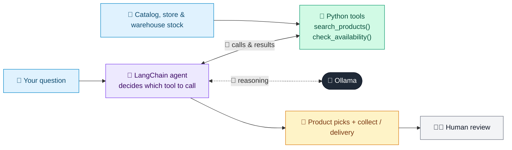

# 06 · Online Shopping Assistant

  

**Industry:** 🛒 Retail · **Category:** 💬 E-commerce & Customer Service

## 🛒 The business problem (new to retail? start here)

**In the business today:** Shoppers on the website or app ask what to buy and whether they can get it today. Store and contact-centre staff answer by checking the catalog and the stock system.

**Who does this work:** E-commerce and customer service teams, and store colleagues.

**Why it's hard:** Customers want a fast, personal answer. A wrong answer about price or stock, like promising an item is in store when it isn't, loses the sale and the customer's trust.

### Key terms
- **Click-and-collect**: Order online, then pick the item up in a store.
- **Stock-out**: When a product is unavailable: a lost sale and an unhappy customer.

More terms: [Retail Primer & glossary](../PRIMER.md#glossary)

---

## 🤖 What the AI does
Helps shoppers find the right product, then checks store stock for click-and-collect and delivery options.

### How it works
Tools search the catalog with price and size filters, check live stock by store and city, and quote delivery; the agent recommends only what the tools return, so it never invents products, prices or stock.



<sub>🟦 data · 🟩 Python: maths & rules (auditable) · 🟪 AI: reasoning & writing · ⬛ local LLM · 🟨 result</sub>

## 💬 Sample conversation

A real recorded run on `qwen2.5:7b-instruct` (local, on a laptop, 12 s). Expand a step to see what happened
behind the answer. LLM wording changes from run to run; the numbers from Python stay the same.

> **👤 You:** I need running shoes for flat feet, size 10, under 100. Can I pick them up in Austin today?

<details><summary>🔧 Tool calls</summary>

```text
search_products(query='running shoes flat feet', size=10, max_price=100) -> [{"sku": "RS-01", "name": "Stridewell Stability 5", "price": 94.99, "rating": 4.6, "suits": "running shoe road stability support flat feet overpronation"}, {"sku": "RS-04", "name": "Stridewell Stability 5 Wide", "price": 99.99, "rating": 4.5, "suits": "running shoe road stability support flat feet overpronation wide fit"}, {"sku": "AC-01", "name": "ArchFit support insoles", "price": 24.99, "rating
check_availability(city='Austin', sku='RS-01', size=10) -> {"sku": "RS-01", "size": 10.0, "units_by_store": {"Austin - South Congress": 1, "Austin - Domain": 0}, "collect_today": "ready in 1 hour at Austin - South Congress", "standard_delivery": "3-5 days, free", "express_delivery": "next day if ordered before 8pm, 7.99"}
check_availability(sku='RS-04', size=10, city='Austin') -> {"sku": "RS-04", "size": 10.0, "units_by_store": "no stores in Austin stock it", "collect_today": "not available to collect today", "standard_delivery": "3-5 days, free", "express_delivery": "next day if ordered before 8pm, 7.99"}
check_availability(sku='AC-01', size=10, city='Austin') -> {"sku": "AC-01", "size": 10.0, "units_by_store": {"Austin - Domain": 6, "Austin - South Congress": 3}, "collect_today": "ready in 1 hour at Austin - Domain, Austin - South Congress", "standard_delivery": "3-5 days, 4.99", "express_delivery": "next day if ordered before 8pm, 7.99"}
```

</details>

**🦙 Ollama:**

Here are the options for running shoes for flat feet, size 10, under $100:

1. **Stridewell Stability 5 (SKU: RS-01)**
   - Price: $94.99
   - Why it suits you: This shoe is designed for stability and support, making it ideal for flat feet and overpronation.
   - Collection: Ready in 1 hour at Austin - South Congress.
   - Delivery: Free standard delivery in 3-5 days.

2. **Stridewell Stability 5 Wide (SKU: RS-04)**
   - Price: $99.99
   - Unfortunately, this shoe is not available to collect in Austin today. However, you can order it for standard delivery in 3-5 days for free or express delivery the next day for $7.99.

3. **ArchFit support insoles (SKU: AC-01)**
   - Price: $24.99
   - While not a shoe, these insoles can provide additional support for your flat feet. They are available for collection at both Austin - Domain and Austin - South Congress in 1 hour.
   - Delivery: Standard delivery is $4.99 for 3-5 days.

The Stridewell Stability 5 (SKU: RS-01) is the best option for you, as it fits your budget and provides the necessary support for your flat feet. You can collect it today from Austin - South Congress. If you need more support, consider the ArchFit insoles as well.


## Run
```bash
# from the repo root, with Ollama running
python 02_retail/06_online_shopping_assistant/app.py
```

## Customize
- Replace the sample data at the top of `app.py` with your own data source (CSV, database, API).
- Tune thresholds and rules in the Python functions. These are the auditable part of the solution.
- Change the model with `OLLAMA_MODEL` (see the root [README](../../README.md#-model-recommendations)).

> Sample data is fictional; calculations are simplified for learning.

[⬅ Back to Retail use cases](../README.md#-use-cases) · [All industries](../../README.md)
