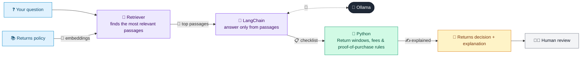

# 07 · Returns & Refund Policy Assistant (RAG)

  

**Industry:** 🛒 Retail · **Category:** 💬 E-commerce & Customer Service

## 🛒 The business problem (new to retail? start here)

**In the business today:** Customers ask whether they can return an item and how they'll be refunded. Service staff look up the returns policy, check the dates and proof of purchase, and explain the decision.

**Who does this work:** Customer service agents and store customer-desk staff.

**Why it's hard:** Returns policies have many rules (time windows, electronics, final sale, hygiene, faulty items) and staff apply them inconsistently. Customers must get the same correct answer everywhere.

### Key terms
- **Restocking fee**: A share of the price kept back on some opened returns, to cover checking, repackaging and reselling the item.
- **Final sale**: Items, usually on clearance, sold on the condition that they can't be returned unless faulty.
- **Proof of purchase**: A receipt, order confirmation or the payment card used, showing when and where an item was bought.

More terms: [Retail Primer & glossary](../PRIMER.md#glossary)

---

## 🤖 What the AI does
Answers "can I return this?" questions with a decision based on the store's returns policy.

### How it works
Retrieval finds the relevant policy sections, the LLM turns the customer's message into a returns checklist, Python applies the rules (return windows, restocking fee, final sale, proof of purchase) and the LLM explains.



<sub>🟦 data · 🟩 Python: maths & rules (auditable) · 🟪 AI: reasoning & writing · ⬛ local LLM · 🟨 result</sub>

## 💬 Sample conversation

A real recorded run on `qwen2.5:7b-instruct` (local, on a laptop, 16 s). Expand a step to see what happened
behind the answer. LLM wording changes from run to run; the numbers from Python stay the same.

> **👤 You:** I bought a laptop 10 days ago and opened it, but I don't like it. Can I return it? I have the receipt.

**🦙 Ollama:**

**RETURN ACCEPTED** (Section 2 Electronics, Section 5 Proof of purchase)

According to our policy, you can return the laptop within 15 days of purchase, and since you have the receipt, we can process your return. However, as the laptop was opened, a 15% restocking fee will apply. You will be refunded via your original payment method. If you need any further assistance or have other options, please let us know.

---

> **👤 You:** Can I return a swimsuit I bought on clearance 5 days ago? I tried it on.

**🦙 Ollama:**

**RETURN DECLINED** (Section 3 Final sale)

I understand you'd like to return the swimsuit you purchased on clearance. According to our policy, [Section 3 Final sale] items marked as final sale, like clearance items, cannot be returned or exchanged unless they are faulty. Since your swimsuit is marked as a final sale, it cannot be returned. However, if the swimsuit is faulty, please contact us and we can assist you further.

---

> **👤 You:** My blender stopped working after 3 months. I have the order confirmation email.

**🦙 Ollama:**

**RETURN ACCEPTED** (Section 4 Faulty items, Section 5 Proof of purchase)

Thank you for reaching out. According to our policy, as your blender developed a fault within the first year of purchase, we can accept a return and offer a repair, replacement, or refund for the blender. Since you have the order confirmation email, which is acceptable proof of purchase, we can proceed with this. There will be no restocking fee. Please let us know if you'd like to proceed with a repair or replacement, or if you prefer a refund.

---

> **👤 You:** I lost the receipt for a jacket I bought 20 days ago, but I paid with my debit card. It still has the tags.

**🦙 Ollama:**

**RETURN ACCEPTED** (Section 1 Standard returns, Section 5 Proof of purchase)

Thank you for understanding, [Section 5 Proof of purchase] allows us to accept your debit card as proof of purchase since your purchase was within the last 90 days. Therefore, we can process a refund for your jacket. The refund will be returned to your original payment method. If you need any further assistance or an alternative like store credit, please let us know.


## Run
```bash
# from the repo root, with Ollama running
python 02_retail/07_returns_policy_assistant/app.py
```

## Customize
- Replace the sample data at the top of `app.py` with your own data source (CSV, database, API).
- Tune thresholds and rules in the Python functions. These are the auditable part of the solution.
- Change the model with `OLLAMA_MODEL` (see the root [README](../../README.md#-model-recommendations)).

> Sample data is fictional; calculations are simplified for learning.

[⬅ Back to Retail use cases](../README.md#-use-cases) · [All industries](../../README.md)
