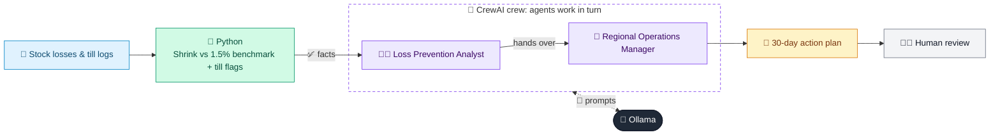

# 08 · Store Shrink & Loss Prevention Analyzer

  

**Industry:** 🛒 Retail · **Category:** 🏬 Store Operations & Loss Prevention

## 🛒 The business problem (new to retail? start here)

**In the business today:** Every quarter, stock counts show how much stock was lost. The loss prevention team works out where and why, and agrees actions with store managers.

**Who does this work:** Loss prevention analysts, regional and store managers.

**Why it's hard:** Losses mix theft, damage, waste and paperwork errors, and each needs a different fix. Unusual till activity must be reviewed fairly, without accusing staff on numbers alone.

### Key terms
- **Shrink**: Stock that is lost instead of sold (theft, damage, waste, admin errors), usually shown as a % of sales.
- **Known vs unknown loss**: Known loss is recorded when it happens (waste, damage); unknown loss only shows up as a gap at the stock count (theft, errors).
- **Till exceptions**: Unusual till activity, like refunds without a receipt or cancelled items, that loss prevention teams review.

More terms: [Retail Primer & glossary](../PRIMER.md#glossary)

---

## 🤖 What the AI does
Finds why stores lose more stock than they should and writes a 30-day action plan.

### How it works
Python splits shrink into known loss (waste, damage) and unknown loss (theft, errors), compares stores to the 1.5% benchmark and flags unusual till refunds and voids for review; a Loss Prevention Analyst agent finds the causes and a Regional Operations Manager agent writes the plan.



<sub>🟦 data · 🟩 Python: maths & rules (auditable) · 🟪 AI: reasoning & writing · ⬛ local LLM · 🟨 result</sub>

## 💬 Sample conversation

A real recorded run on `qwen2.5:7b-instruct` (local, on a laptop, 26 s). Expand a step to see what happened
behind the answer. LLM wording changes from run to run; the numbers from Python stay the same.

> **👤 You:** Why is shrink above target at some stores this quarter, and what should we do about it?

<details><summary>🐍 Python · Shrink facts</summary>

```json
{
  "benchmark_shrink_pct": 1.5,
  "stores": [
    {
      "store": "S-01 Downtown",
      "shrink_pct": 1.25,
      "known_loss": 14000,
      "unknown_loss": 16000,
      "status": "OK",
      "main_driver": "unknown loss (theft or admin errors)",
      "loss_reduction_needed_per_quarter": 0,
      "target": "stay at or below the benchmark",
      "top_loss_lines": {
        "expired fresh": 9000,
        "health & beauty": 6000
      }
    },
    {
      "store": "S-02 Riverside",
      "shrink_pct": 1.31,
      "known_loss": 12500,
      "unknown_loss": 11000,
      "status": "OK",
      "main_driver": "known loss (waste and damage)",
      "loss_reduction_needed_per_quarter": 0,
      "target": "stay at or below the benchmark",
      "top_loss_lines": {
        "expired fresh": 8000,
        "damaged": 4500
      }
    },
    {
      "store": "S-03 Airport Mall",
      "shrink_pct": 2.67,
      "known_loss": 15000,
      "unknown_loss": 41000,
      "status": "ABOVE BENCHMARK",
      "main_driver": "unknown loss (theft or admin errors)",
      "loss_reduction_needed_per_quarter": 24500,
      "target": "cut losses by 24,500 a quarter to get back to 1.5% of sales",
      "top_loss_lines": {
        "health & beauty": 18500,
        "electronics accessories": 12000
      }
    },
    {
      "store": "S-04 Lakeside",
      "shrink_pct": 2.47,
      "known_loss": 31000,
      "unknown_loss": 6000,
      "status": "ABOVE BENCHMARK",
      "main_driver": "known loss (waste and damage)",
      "loss_reduction_needed_per_quarter": 14500,
      "target": "cut losses by 14,500 a quarter to get back to 1.5% of sales",
      "top_loss_lines": {
        "expired fresh": 24000,
        "damaged": 7000
      }
    }
  ],
  "till_exceptions_to_review": [
    {
      "store": "S-03 Airport Mall",
      "cashier_id": "C-312",
      "no_receipt_refunds_per_1000": 8.5,
      "post_total_voids_per_1000": 7.9,
      "chain_median_refunds": 1.1,
      "chain_median_voids": 1.5
    }
  ],
  "note": "Till flags are a reason to review CCTV and till logs, not proof of wrongdoing."
}
```

</details>

<details><summary>🧑‍💼 Loss Prevention Analyst (agent)</summary>

Findings per store:

### S-03 Airport Mall
- **Main Driver:** Unknown loss (theft or admin errors)
- **Top Loss Lines:**
  - **Health & Beauty:** 18,500
  - **Electronics Accessories:** 12,000
- **Till Exceptions to Review:**
  - **Cashier ID:** C-312
  - **No Receipt Refunds per 1000:** 8.5
  - **Post Total Voids per 1000:** 7.9
  - **Chain Median Refunds:** 1.1
  - **Chain Median Voids:** 1.5

### S-04 Lakeside
- **Main Driver:** Known loss (waste and damage)
- **Top Loss Lines:**
  - **Expired Fresh:** 24,000
  - **Damaged:** 7,000
- **Till Exceptions to Review:**
  - **No further till exceptions provided for S-04 Lakeside.**

### Summary of Likely Causes:
- **S-03 Airport Mall:**
  - **Health & Beauty:** This category might be prone to theft or admin errors, such as incorrect pricing, misplacement, or unauthorized returns.
  - **Electronics Accessories:** This category could also be a target for theft, especially if items are easily accessible or have a high perceived value.
  - **Till Exceptions:** The high rate of no receipt refunds and post-total voids could indicate potential issues with cashier practices or system errors, which should be reviewed through CCTV and till logs.

- **S-04 Lakeside:**
  - **Expired Fresh:** This category is likely experiencing waste due to expiration or damage, possibly due to poor inventory management or handling practices.
  - **Damaged:** Items that are damaged might be written off or discarded, leading to shrinkage.
  - **Till Exceptions:** No specific till exceptions were provided for S-04 Lakeside, but if any were present, they should be reviewed similarly to S-03 Airport Mall.

### Recommendations:
- Conduct a thorough review of the top loss lines to identify any patterns or discrepancies.
- Investigate the till exceptions to ensure there are no system or procedural issues.
- Implement additional training for staff handling high-value or perishable items.
- Review and update inventory management practices to reduce waste.
- Monitor and address any unusual activity in the till to prevent potential losses.

</details>

**🦙 Ollama:**

### 30-Day Action Plan for Stores Above Benchmark

#### S-03 Airport Mall
1. **Action:** Conduct a detailed review of the health & beauty and electronics accessories sections to identify any discrepancies in pricing, stock levels, and handling procedures.  
   **Owner:** Store Manager  
2. **Action:** Implement protective packaging and tagging for high-theft items in the health & beauty and electronics accessories sections to reduce the risk of theft.  
   **Owner:** Loss Prevention Team  
3. **Action:** Review CCTV footage and till logs for cashier ID C-312 to identify any potential issues with no receipt refunds and post-total voids.  
   **Owner:** IT and Security Team  
4. **Action:** Provide additional training for staff on handling high-value and sensitive items to ensure proper procedures are followed.  
   **Owner:** HR and Training Team

**Target:** "cut losses by 24,500 a quarter to get back to 1.5% of sales"

---

#### S-04 Lakeside
1. **Action:** Conduct a thorough review of the expired fresh and damaged sections to identify any issues with inventory management and handling practices.  
   **Owner:** Store Manager  
2. **Action:** Implement protective packaging and regular rotation of fresh items to minimize waste and ensure freshness.  
   **Owner:** Loss Prevention Team  
3. **Action:** Review and update inventory management practices to reduce waste and ensure proper handling of damaged items.  
   **Owner:** Inventory Management Team  
4. **Action:** Monitor and address any unusual activity in the till to prevent potential losses.  
   **Owner:** IT and Security Team

**Target:** "cut losses by 14,500 a quarter to get back to 1.5% of sales"


## Run
```bash
# from the repo root, with Ollama running
python 02_retail/08_shrink_loss_analyzer/app.py
```

## Customize
- Replace the sample data at the top of `app.py` with your own data source (CSV, database, API).
- Tune thresholds and rules in the Python functions. These are the auditable part of the solution.
- Change the model with `OLLAMA_MODEL` (see the root [README](../../README.md#-model-recommendations)).

> Sample data is fictional; calculations are simplified for learning.

[⬅ Back to Retail use cases](../README.md#-use-cases) · [All industries](../../README.md)
