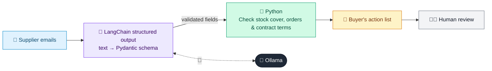

# 09 · Supplier Notice Extractor

  

**Industry:** 🛒 Retail · **Category:** 📦 Supply Chain & Inventory

## 🛒 The business problem (new to retail? start here)

**In the business today:** Buyers receive a steady stream of supplier emails: late deliveries, price rises, short shipments and pack changes. Each one has to be read, checked and acted on.

**Who does this work:** Buyers and supply chain planners.

**Why it's hard:** The important details are buried in free text, and the impact depends on our own stock and contract terms. Missing one email can mean empty shelves or paying more than the contract allows.

### Key terms
- **Purchase order (PO)**: A formal order to a supplier: which products, how many, at what price and when to deliver.
- **Short shipment**: A delivery with fewer units than were ordered.
- **Shrinkflation**: A smaller pack sold at the same price: a hidden price increase.
- **Lead time**: How long a supplier takes to deliver after an order is placed.
- **Weeks of cover**: How many weeks current stock will last at forecast sales.
- **Stock-out**: When a product is unavailable: a lost sale and an unhappy customer.

More terms: [Retail Primer & glossary](../PRIMER.md#glossary)

---

## 🤖 What the AI does
Turns supplier emails about delays, price rises, short shipments and pack changes into a buyer's action list.

### How it works
Each email is first classified (delay, price change, short shipment, substitution), then the details for that type are extracted into a small Pydantic schema; Python checks them against stock cover and the supplier contract (stock-out risk, notice period, price cap, hidden pack-size increases); an LLM chain writes the actions.



<sub>🟦 data · 🟩 Python: maths & rules (auditable) · 🟪 AI: reasoning & writing · ⬛ local LLM · 🟨 result</sub>

## 💬 Sample conversation

A real recorded run on `qwen2.5:7b-instruct` (local, on a laptop, 19 s). Expand a step to see what happened
behind the answer. LLM wording changes from run to run; the numbers from Python stay the same.

> **👤 You:** We've had four supplier emails this morning. What do they mean for our stock and costs?

<details><summary>🧾 Extracted · Nordic Dairy Co</summary>

```json
{
  "notice_type": "delay",
  "sku": "SKU-101",
  "original_date": "14 Oct 2026",
  "new_date": "21 Oct 2026 product_name: Organic oat milk 1L (SKU-101), quantity: 1,200 units, supplier: Nordic Dairy Co"
}
```

</details>

<details><summary>🧾 Extracted · SunShield Labs</summary>

```json
{
  "notice_type": "price_change",
  "sku": "SKU-102",
  "old_cost": 4.8,
  "new_cost": 5.3,
  "effective_date": "2026-11-01T00:00:00Z+00:00"
}
```

</details>

<details><summary>🧾 Extracted · WoolWorks Ltd</summary>

```json
{
  "notice_type": "short_shipment",
  "sku": "SKU-103",
  "qty_ordered": 200,
  "qty_shipped": 120
}
```

</details>

<details><summary>🧾 Extracted · PastaPrima</summary>

```json
{
  "notice_type": "substitution",
  "sku": "SKU-210",
  "old_pack_size": 500.0,
  "new_pack_size": 450.0
}
```

</details>

<details><summary>🐍 Python · Validation</summary>

```json
[
  {
    "supplier": "Nordic Dairy Co",
    "sku": "SKU-101",
    "type": "delay",
    "days_of_stock_cover": 8.9,
    "delivery_in_days": 11,
    "stockout_risk": true,
    "days_without_stock": 2
  },
  {
    "supplier": "SunShield Labs",
    "sku": "SKU-102",
    "type": "price_change",
    "days_of_stock_cover": 10.2,
    "increase_pct": 10.4,
    "notice_days": 22,
    "breaches_contract": true,
    "contract_terms": "max 3.0% increase, 60 days notice",
    "extra_cost_per_year": 6760
  },
  {
    "supplier": "WoolWorks Ltd",
    "sku": "SKU-103",
    "type": "short_shipment",
    "days_of_stock_cover": 298.7,
    "shortfall_units": 80,
    "stockout_risk": false,
    "overstocked_so_cancel_balance": true
  },
  {
    "supplier": "PastaPrima",
    "sku": "SKU-210",
    "type": "substitution",
    "days_of_stock_cover": 25.7,
    "pack_change": "500 -> 450",
    "hidden_cost_increase_pct": 11.1,
    "needs": "new barcode, product listing and shelf-edge unit price"
  }
]
```

</details>

**🦙 Ollama:**

**Action List:**

1. **Nordic Dairy Co (SKU-101) - Stock-out Risk**
   - **What Happened:** Expected delivery in 11 days, but only 8.9 days of stock cover.
   - **Impact:** 2 days without stock.
   - **Action:** Expedite the order to ensure stock is replenished within 2 days.

2. **SunShield Labs (SKU-102) - Contract Breach**
   - **What Happened:** Price increase of 10.4%, exceeding the contract terms of a maximum 3.0% increase with 60 days notice.
   - **Impact:** Additional cost of $6,760 per year.
   - **Action:** Push back on the price increase citing the contract terms. Negotiate a reduction or seek alternative suppliers.

3. **WoolWorks Ltd (SKU-103) - Short Shipment**
   - **What Happened:** Short shipment of 80 units, with 298.7 days of stock cover.
   - **Impact:** No immediate stockout risk.
   - **Action:** Cancel the balance of the order and update inventory records to reflect the shortfall.

4. **PastaPrima (SKU-210) - Substitution**
   - **What Happened:** Pack size changed from 500 to 450, with a hidden cost increase of 11.1%.
   - **Impact:** Requires new barcode, product listing, and shelf-edge unit price updates.
   - **Action:** Update product listings, shelf labels, and barcodes to reflect the new pack size and price.


## Run
```bash
# from the repo root, with Ollama running
python 02_retail/09_supplier_notice_extractor/app.py
```

## Customize
- Replace the sample data at the top of `app.py` with your own data source (CSV, database, API).
- Tune thresholds and rules in the Python functions. These are the auditable part of the solution.
- Change the model with `OLLAMA_MODEL` (see the root [README](../../README.md#-model-recommendations)).

> Sample data is fictional; calculations are simplified for learning.

[⬅ Back to Retail use cases](../README.md#-use-cases) · [All industries](../../README.md)
