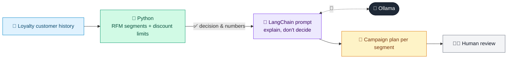

# 10 · Customer Segmentation & Campaign Planner

  

**Industry:** 🛒 Retail · **Category:** 🙋 Customer Insight

## 🛒 The business problem (new to retail? start here)

**In the business today:** The CRM team groups loyalty-card customers by how they shop and sends each group a different campaign.

**Who does this work:** CRM and loyalty marketing teams.

**Why it's hard:** Sending the same discount to everyone wastes money on customers who would buy anyway and does too little for those about to leave.

### Key terms
- **RFM**: Recency, Frequency, Monetary value: scoring customers on how recently, how often and how much they buy.
- **Customer segment**: A group of customers who behave alike and get the same marketing approach.
- **Win-back campaign**: An offer aimed at valuable customers who have stopped buying.
- **Control group**: Customers deliberately left out of a campaign so its real effect can be measured.

More terms: [Retail Primer & glossary](../PRIMER.md#glossary)

---

## 🤖 What the AI does
Groups loyalty customers into segments and plans a marketing campaign for each.

### How it works
Python scores customers on recency, frequency and spend (RFM), sizes each segment's share of revenue and sets its discount limit; an LLM chain writes the offer, channel and message for every segment within those limits.



<sub>🟦 data · 🟩 Python: maths & rules (auditable) · 🟪 AI: reasoning & writing · ⬛ local LLM · 🟨 result</sub>

## 💬 Sample conversation

A real recorded run on `qwen2.5:7b-instruct` (local, on a laptop, 15 s). Expand a step to see what happened
behind the answer. LLM wording changes from run to run; the numbers from Python stay the same.

> **👤 You:** Who are our customer segments, and what campaign should each one get?

<details><summary>🐍 Python · RFM segments</summary>

```json
[
  {
    "segment": "Champions",
    "customers": 3,
    "share_of_revenue_pct": 45,
    "avg_spend": 1867,
    "avg_orders": 14.3,
    "avg_days_since_last_order": 14,
    "max_discount_pct": 0,
    "guardrail": "they buy anyway: reward with early access, not discounts",
    "customer_ids": [
      "CU-01",
      "CU-02",
      "CU-03"
    ]
  },
  {
    "segment": "Loyal",
    "customers": 3,
    "share_of_revenue_pct": 19,
    "avg_spend": 787,
    "avg_orders": 7.0,
    "avg_days_since_last_order": 38,
    "max_discount_pct": 5,
    "guardrail": "nudge toward Champions with bonus points",
    "customer_ids": [
      "CU-04",
      "CU-05",
      "CU-06"
    ]
  },
  {
    "segment": "New",
    "customers": 3,
    "share_of_revenue_pct": 2,
    "avg_spend": 82,
    "avg_orders": 1.3,
    "avg_days_since_last_order": 10,
    "max_discount_pct": 10,
    "guardrail": "win the second purchase",
    "customer_ids": [
      "CU-07",
      "CU-08",
      "CU-09"
    ]
  },
  {
    "segment": "At risk",
    "customers": 3,
    "share_of_revenue_pct": 27,
    "avg_spend": 1133,
    "avg_orders": 9.0,
    "avg_days_since_last_order": 122,
    "max_discount_pct": 15,
    "guardrail": "win back valuable customers before they lapse",
    "customer_ids": [
      "CU-10",
      "CU-11",
      "CU-12"
    ]
  },
  {
    "segment": "Hibernating",
    "customers": 4,
    "share_of_revenue_pct": 6,
    "avg_spend": 201,
    "avg_orders": 2.8,
    "avg_days_since_last_order": 206,
    "max_discount_pct": 0,
    "guardrail": "low-cost email only; don't spend on customers unlikely to return",
    "customer_ids": [
      "CU-13",
      "CU-14",
      "CU-15",
      "CU-16"
    ]
  }
]
```

</details>

**🦙 Ollama:**

### Segment: At Risk
**Goal:** To re-engage customers who are at risk of lapsing by offering a compelling incentive to return.

**Offer:** 15% off their next purchase.

**Channel:** Email

**One-Line Message Idea:** "Don't let us go cold! Get 15% off your next order and stay warm with us."

**Why:** This segment represents 27% of the revenue and has a high average spend, making them valuable to retain. Offering a significant discount can incentivize them to make another purchase before they lapse.

### Segment: Champions
**Goal:** To reward loyal customers with early access to new products or services.

**Offer:** Early access to a new product launch.

**Channel:** App Push Notification

**One-Line Message Idea:** "Be the first to try our new [product name]! Get early access now."

**Why:** Champions already buy frequently and in high volumes. Rewarding them with exclusive access can further cement their loyalty and encourage repeat purchases.

### Segment: Loyal
**Goal:** To nudge loyal customers toward the Champions tier by offering bonus points.

**Offer:** 5% bonus points on their next purchase.

**Channel:** App Push Notification

**One-Line Message Idea:** "Stay loyal and earn more! Get 5% bonus points on your next order."

**Why:** This segment has a 19% share of revenue and is close to the Champions tier. Offering bonus points can motivate them to increase their spend and frequency, moving them closer to the Champions level.

### Segment: New
**Goal:** To incentivize new customers to make a second purchase.

**Offer:** 10% off their second purchase.

**Channel:** Email

**One-Line Message Idea:** "Love what you bought? Get 10% off your second purchase!"

**Why:** This segment has a low share of revenue but represents potential future high-value customers. Encouraging them to make a second purchase can significantly increase their lifetime value.

### Segment: Hibernating
**Goal:** To maintain low-cost engagement with customers unlikely to return.

**Offer:** None; focus on re-engagement through content.

**Channel:** Email

**One-Line Message Idea:** "We miss you! Stay connected with our latest news and offers."

**Why:** This segment has a low share of revenue and is unlikely to return. The focus is on maintaining a low-cost engagement strategy to keep the possibility of future purchases open.

### Measuring Success:
- **At Risk:** Track the number of re-engaged customers and their subsequent purchase behavior.
- **Champions:** Monitor the frequency and value of their purchases post-campaign.
- **Loyal:** Measure the increase in spend and frequency among these customers.
- **New:** Track the conversion rate of new customers to repeat customers.
- **Hibernating:** Assess the engagement level and any potential future purchases.

By implementing these targeted campaigns, we can effectively manage and grow our customer base, ensuring the highest return on investment.


## Run
```bash
# from the repo root, with Ollama running
python 02_retail/10_customer_segmentation/app.py
```

## Customize
- Replace the sample data at the top of `app.py` with your own data source (CSV, database, API).
- Tune thresholds and rules in the Python functions. These are the auditable part of the solution.
- Change the model with `OLLAMA_MODEL` (see the root [README](../../README.md#-model-recommendations)).

> Sample data is fictional; calculations are simplified for learning.

[⬅ Back to Retail use cases](../README.md#-use-cases) · [All industries](../../README.md)
