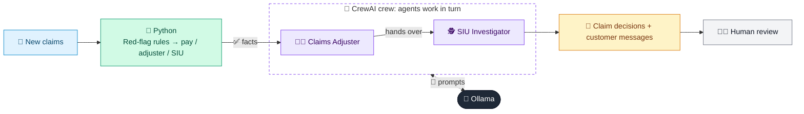

# 01 · Claims Triage & Fraud Detection

  

**Industry:** 🛡️ Insurance · **Category:** 🧾 Claims & Fraud

## 🛡️ The business problem (new to insurance? start here)

**In the business today:** When a customer reports a loss, claims handlers decide how to handle it: pay simple claims fast, send complex ones to an adjuster, and refer suspicious ones to the fraud team.

**Who does this work:** Claims handlers, adjusters and the Special Investigations Unit (SIU).

**Why it's hard:** Honest customers expect quick payment, but fraud is expensive. Handlers must spot red flags without treating genuine customers as suspects, and must not miss chances to recover costs from at-fault third parties.

### Key terms
- **FNOL**: First Notice of Loss: the first report of a claim to the insurer.
- **Claims triage**: Sorting new claims by complexity and risk: fast-track simple ones, send complex ones to experts.
- **Adjuster**: The claims professional who assesses a claim and decides what the insurer pays.
- **Insurance fraud**: Exaggerating or inventing a claim. Fraud costs insurers billions, raising premiums for everyone.
- **Red flag**: A warning sign of possible fraud, e.g. a claim soon after the policy started or no proof of ownership.
- **SIU**: Special Investigations Unit: the team that investigates suspected fraud.
- **Subrogation**: Recovering what the insurer paid from a third party who caused the loss, e.g. the at-fault driver's insurer.
- **Sum insured**: The maximum the insurer will pay for a policy or item.

More terms: [Insurance Primer & glossary](../PRIMER.md#glossary)

---

## 🤖 What the AI does
Triages new claims into fast-track, adjuster review or fraud investigation, and spots recovery opportunities.

### How it works
Python applies red-flag rules (new policy, late reporting, near sum insured, prior claims) and decides the handling (pay, adjuster review, SIU referral), so no honest customer is flagged by the AI; a Claims Adjuster agent assesses each claim and an SIU Investigator agent writes evidence requests, customer messages and recovery actions.



<sub>🟦 data · 🟩 Python: maths & rules (auditable) · 🟪 AI: reasoning & writing · ⬛ local LLM · 🟨 result</sub>

## 💬 Sample conversation

A real recorded run on `qwen2.5:7b-instruct` (local, on a laptop). Expand a step to see what happened
behind the answer. LLM wording changes from run to run; the numbers from Python stay the same.

> **👤 You:** Triage this morning's new claims. Which can we pay, and which need an adjuster or a fraud check?

<details><summary>🐍 Python · Triage (rules)</summary>

```json
[
  {
    "id": "CLM-501",
    "fraud_score": 0,
    "red_flags": [
      "none"
    ],
    "route": "Fast-track payment",
    "final_handling": "PAY",
    "subrogation_opportunity": false
  },
  {
    "id": "CLM-502",
    "fraud_score": 100,
    "red_flags": [
      "Loss 23 days after policy start",
      "Reported 21 days after loss",
      "Claim close to sum insured",
      "2 prior claims in 3 years",
      "No proof of ownership",
      "No forced entry on a burglary claim"
    ],
    "route": "SIU referral",
    "final_handling": "REFER TO SIU",
    "subrogation_opportunity": false
  },
  {
    "id": "CLM-503",
    "fraud_score": 0,
    "red_flags": [
      "none"
    ],
    "route": "Adjuster review",
    "final_handling": "ADJUSTER REVIEW, THEN PAY IF VALID",
    "subrogation_opportunity": true
  }
]
```

</details>

**🦙 Ollama:**

### Claim CLM-501: Home - Escape of Water

- **Final Handling:** PAY
- **Evidence Needed:**
  - Plumber's invoice for repairs.
  - Photos of the damage before and after repairs.
  - Any manufacturer's warranty or recall information for the washing machine.
- **Customer Message:**
  Thank you for your claim. We have reviewed the information provided and are pleased to inform you that the damage is covered under your policy. Please ensure that the plumber's invoice and any relevant photos are submitted for processing. If you have any further questions, feel free to contact us.
- **Recovery Action:**
  None.

---

### Claim CLM-502: Home - Theft

- **Final Handling:** REFER TO SIU
- **Evidence Needed:**
  - Police report or incident report.
  - Receipts or purchase documents for the stolen items.
  - Proof of ownership for the stolen items.
  - Any security system logs or other evidence of the break-in.
- **Customer Message:**
  We appreciate your prompt reporting of the incident. To ensure a thorough investigation, we need to gather additional information. Please provide the police report, any receipts or purchase documents, and any other relevant evidence. If you have any security system logs or other evidence, please share them as well. We will review this information and keep you updated.
- **Recovery Action:**
  None.

---

### Claim CLM-503: Motor - Collision

- **Final Handling:** ADJUSTER REVIEW, THEN PAY IF VALID
- **Evidence Needed:**
  - Third party's insurance information and contact details.
  - Dashcam footage of the incident.
  - Police report or accident report.
  - Repair estimates and invoices.
- **Customer Message:**
  We have received your claim and are currently reviewing the information provided. To ensure a fair and accurate assessment, we need to gather additional details. Please provide the third party's insurance information, any dashcam footage, the police report, and repair estimates and invoices. If you have any further information, please share it with us. We will review this information and keep you updated.
- **Recovery Action:**
  If the claim is valid and the third party is responsible, we will pursue subrogation to recover the costs from the at-fault party. Please be assured that we will handle this process discreetly and professionally.

These steps will ensure that each claim is handled appropriately and fairly.


## Run
```bash
# from the repo root, with Ollama running
python 03_insurance/01_claims_triage_fraud/app.py
```

## Customize
- Replace the sample data at the top of `app.py` with your own data source (CSV, database, API).
- Tune thresholds and rules in the Python functions. These are the auditable part of the solution.
- Change the model with `OLLAMA_MODEL` (see the root [README](../../README.md#-model-recommendations)).

> Sample data is fictional; calculations are simplified for learning.

[⬅ Back to Insurance use cases](../README.md#-use-cases) · [All industries](../../README.md)
