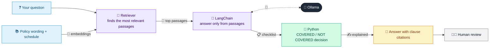

# 02 · Policy Coverage Q&A (RAG)

  

**Industry:** 🛡️ Insurance · **Category:** 🙋 Policy & Customer Service

## 🛡️ The business problem (new to insurance? start here)

**In the business today:** Customers call the helpline asking 'am I covered for this?'. Staff check the policy wording and the customer's schedule, then explain the answer and the excess.

**Who does this work:** Contact centre and claims helpline teams.

**Why it's hard:** Policy wordings are long and full of exclusions and conditions. Answers depend on which add-ons the customer bought, and wrong answers lead to complaints.

### Key terms
- **Policy wording / schedule**: The wording is the full contract (what is and isn't covered); the schedule lists this customer's chosen covers and limits.
- **Exclusion**: Something the policy specifically does not cover, e.g. wear and tear.
- **Add-on cover**: Optional extra cover bought on top of the core policy, e.g. accidental damage.
- **Excess (deductible)**: The amount the customer pays towards each claim before the insurer pays the rest.

More terms: [Insurance Primer & glossary](../PRIMER.md#glossary)

---

## 🤖 What the AI does
Answers 'am I covered?' questions from the policy wording and the customer's schedule, with clause citations.

### How it works
Relevant clauses are retrieved (the schedule and excess are always included); the LLM fills a coverage checklist (matching section, conditions met) and checks each exclusion sentence; Python decides COVERED / NOT COVERED from the customer's schedule; the LLM explains the decision with citations.



<sub>🟦 data · 🟩 Python: maths & rules (auditable) · 🟪 AI: reasoning & writing · ⬛ local LLM · 🟨 result</sub>

## 💬 Sample conversation

A real recorded run on `qwen2.5:7b-instruct` (local, on a laptop, 27 s). Expand a step to see what happened
behind the answer. LLM wording changes from run to run; the numbers from Python stay the same.

> **👤 You:** My washing machine hose burst and flooded the kitchen. Am I covered?

**🦙 Ollama:**

**COVERED** (Section 1.1 Escape of water)

Yes, you are covered for this incident. According to Section 1.1 Escape of water in your policy, damage to buildings and contents caused by water escaping from a washing machine is covered. However, please note that the excess for escape of water claims is 500, so you will need to pay this amount out of pocket before we cover the rest of the claim.

---

> **👤 You:** I dropped my TV while moving it. Can I claim?

**🦙 Ollama:**

**NOT COVERED** (Section 1.4 Accidental damage)

I'm sorry, but your claim for accidental damage to your TV is not covered under your policy. According to Section 1.4 Accidental damage, this coverage is not included in your schedule, so unfortunately, you won't be able to make a claim for this incident. There is no excess to pay in this case since the claim is not covered.

---

> **👤 You:** My named Trek bike was stolen outside a cafe; I had locked it to a railing.

**🦙 Ollama:**

**COVERED** (Section 2 Personal Possessions add-on)

Your Trek bicycle, valued at 1,450, was covered under the Personal Possessions add-on (Section 2) because it was stolen while left unattended but locked to a fixed object outside your home. According to the policy, this meets the condition for coverage. However, please note that you will need to pay the excess of 250 for this claim.

---

> **👤 You:** A storm blew down my garden shed.

**🦙 Ollama:**

**NOT COVERED** (Section 1.2 Storm and flood)

I'm sorry, but the damage to your garden shed caused by the storm is not covered under your policy. According to Section 1.2 Storm and flood, we do not cover damage to gates, fences, hedges, or garden sheds caused by storm or flood. There is no excess to pay in this case as the claim is not covered.


## Run
```bash
# from the repo root, with Ollama running
python 03_insurance/02_policy_coverage_qa/app.py
```

## Customize
- Replace the sample data at the top of `app.py` with your own data source (CSV, database, API).
- Tune thresholds and rules in the Python functions. These are the auditable part of the solution.
- Change the model with `OLLAMA_MODEL` (see the root [README](../../README.md#-model-recommendations)).

> Sample data is fictional; calculations are simplified for learning.

[⬅ Back to Insurance use cases](../README.md#-use-cases) · [All industries](../../README.md)
