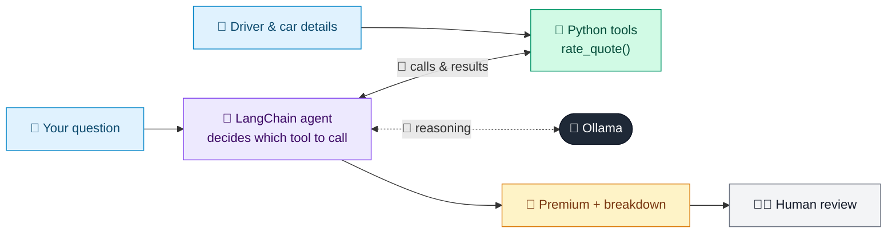

# 03 · Motor Insurance Quote Agent

  

**Industry:** 🛡️ Insurance · **Category:** 📝 Underwriting & Pricing

## 🛡️ The business problem (new to insurance? start here)

**In the business today:** Underwriters and pricing teams set premiums using a rating engine: a base price adjusted by rating factors such as driver age, experience, car and area.

**Who does this work:** Pricing / underwriting teams; customers see the result as a quote.

**Why it's hard:** Customers often don't understand why their quote is high. Clear explanations and 'what if' options (higher excess, lower mileage) help them choose and build trust.

### Key terms
- **Premium**: The price a customer pays for an insurance policy, usually yearly or monthly.
- **Underwriting**: Assessing a risk and deciding whether to insure it and on what terms.
- **Rating factor**: A characteristic that changes the premium, e.g. driver age, car group or postcode.
- **Rating engine**: The system that calculates a premium from a base rate and rating factors.
- **Vehicle (insurance) group**: A 1-50 scale ranking cars by repair cost, performance and security. Higher groups cost more to insure.
- **Voluntary excess**: An extra excess the customer chooses to pay on claims in exchange for a lower premium.
- **Excess (deductible)**: The amount the customer pays towards each claim before the insurer pays the rest.

More terms: [Insurance Primer & glossary](../PRIMER.md#glossary)

---

## 🤖 What the AI does
Prices a car insurance policy, explains what drives the premium and answers what-if questions.

### How it works
A rating-engine tool multiplies a base premium by rating factors (age, experience, car group, area, claims, mileage, excess); the agent explains the breakdown and re-prices what-ifs.



<sub>🟦 data · 🟩 Python: maths & rules (auditable) · 🟪 AI: reasoning & writing · ⬛ local LLM · 🟨 result</sub>

## 💬 Sample conversation

A real recorded run on `qwen2.5:7b-instruct` (local, on a laptop). Expand a step to see what happened
behind the answer. LLM wording changes from run to run; the numbers from Python stay the same.

> **👤 You:** I'm 23, licensed 2 years, driving a group 22 car in a high-risk area, 1 claim in 5 years, 9,000 miles a year. What's my quote, and how much would I save with a 500 voluntary excess?

**🦙 Ollama:**

Based on your details, your annual motor insurance premium would be £1,656.21. This breaks down as follows:

- **Driver Age**: Your age of 23 is a significant factor, increasing the premium by 60%.
- **Experience**: You have been licensed for 2 years, which slightly increases the premium by 15%.
- **Vehicle Group**: The group 22 car increases the premium by 27%.
- **Area Risk**: Driving in a high-risk area increases the premium by 35%.
- **Claims History**: You have one claim in the last 5 years, which increases the premium by 25%.
- **Mileage**: Your annual mileage of 9,000 miles does not affect the premium in this case.

If you choose to increase your voluntary excess to £500, your annual premium would reduce to £1,490.59, saving you £165.62 annually.

Would you like to proceed with this voluntary excess or consider other options?


## Run
```bash
# from the repo root, with Ollama running
python 03_insurance/03_motor_quote_agent/app.py
```

## Customize
- Replace the sample data at the top of `app.py` with your own data source (CSV, database, API).
- Tune thresholds and rules in the Python functions. These are the auditable part of the solution.
- Change the model with `OLLAMA_MODEL` (see the root [README](../../README.md#-model-recommendations)).

> Sample data is fictional; calculations are simplified for learning.

[⬅ Back to Insurance use cases](../README.md#-use-cases) · [All industries](../../README.md)
