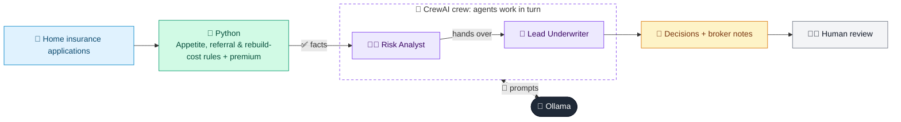

# 04 · Home Insurance Underwriting Assessor

  

**Industry:** 🛡️ Insurance · **Category:** 📝 Underwriting & Pricing

## 🛡️ The business problem (new to insurance? start here)

**In the business today:** Brokers send home insurance applications. Underwriters check each home against the underwriting guide, then accept it, add terms, refer it to a senior colleague or decline it.

**Who does this work:** Home underwriters, with senior underwriters for referrals; brokers pass the decisions to customers.

**Why it's hard:** Every home is different: flood risk, subsidence, old or unusual construction. Customers often underestimate the rebuild cost, which leaves them underinsured when they claim.

### Key terms
- **Underwriting**: Assessing a risk and deciding whether to insure it and on what terms.
- **Risk appetite**: The types and amount of risk the insurer is willing to accept, set by the board.
- **Referral**: Passing a risk the rules can't approve on their own to a more senior underwriter.
- **Rebuild cost**: What it would cost to rebuild the home from scratch. This, not the market price, sets the buildings sum insured.
- **Underinsurance**: Insuring something for less than it is worth. The insurer may then pay only part of each claim.
- **Policy terms (endorsement)**: Special conditions added to one customer's policy, e.g. a higher flood excess.
- **Subsidence**: Ground under a building sinking, which cracks walls. Expensive to fix, so insurers check its history.
- **Sum insured**: The maximum the insurer will pay for a policy or item.

More terms: [Insurance Primer & glossary](../PRIMER.md#glossary)

---

## 🤖 What the AI does
Decides whether to accept, refer or decline new home insurance applications, with terms and a premium.

### How it works
Python applies the underwriting guide: appetite (non-standard construction, too many claims), referral rules (subsidence, listed buildings), a rebuild-cost check that catches underinsurance, and extra excesses, then prices the home; a Risk Analyst agent explains the risks and a Lead Underwriter agent writes the broker notes.



<sub>🟦 data · 🟩 Python: maths & rules (auditable) · 🟪 AI: reasoning & writing · ⬛ local LLM · 🟨 result</sub>

## 💬 Sample conversation

A real recorded run on `qwen2.5:7b-instruct` (local, on a laptop, 25 s). Expand a step to see what happened
behind the answer. LLM wording changes from run to run; the numbers from Python stay the same.

> **👤 You:** Four home insurance applications came in from brokers this morning. Which can we accept, and on what terms?

<details><summary>🐍 Python · Underwriting rules</summary>

```json
[
  {
    "id": "HU-01",
    "summary_line": "HU-01: ACCEPT, premium 216 a year, buildings sum insured 180,000",
    "property": "3-bed semi-detached, 1998",
    "key_risks": [
      "low flood risk",
      "brick, tiled roof",
      "no subsidence in the last 10 years",
      "no claims in the last 5 years"
    ],
    "decision": "ACCEPT",
    "referral_reasons": null,
    "terms": null,
    "rebuild_estimate": 175750,
    "declared_rebuild": 180000,
    "sum_insured_quoted": 180000,
    "indicative_annual_premium": 216
  },
  {
    "id": "HU-02",
    "summary_line": "HU-02: ACCEPT WITH TERMS, premium 654 a year, buildings sum insured 296,000",
    "property": "4-bed detached by the river, 1975",
    "key_risks": [
      "high flood risk",
      "brick, tiled roof",
      "no subsidence in the last 10 years",
      "claims in the last 5 years: escape of water"
    ],
    "decision": "ACCEPT WITH TERMS",
    "referral_reasons": null,
    "terms": [
      "Increase the buildings sum insured from 220,000 to 296,000 (declared is 74% of our rebuild estimate)",
      "Flood excess of 1,000",
      "Escape of water excess of 750"
    ],
    "rebuild_estimate": 296000,
    "declared_rebuild": 220000,
    "sum_insured_quoted": 296000,
    "indicative_annual_premium": 654
  },
  {
    "id": "HU-03",
    "summary_line": "HU-03: REFER TO SENIOR UNDERWRITER, indicative premium 241 a year, subject to referral",
    "property": "2-bed Victorian terrace, 1890",
    "key_risks": [
      "low flood risk",
      "brick, slate roof",
      "subsidence in the last 10 years, structural engineer's certificate supplied",
      "claims in the last 5 years: subsidence"
    ],
    "decision": "REFER TO SENIOR UNDERWRITER",
    "referral_reasons": [
      "Subsidence in the last 10 years (structural engineer's certificate supplied)"
    ],
    "terms": [
      "Subsidence excess of 2,500"
    ],
    "rebuild_estimate": 148000,
    "declared_rebuild": 175000,
    "sum_insured_quoted": 175000,
    "indicative_annual_premium": "241 (subject to referral)"
  },
  {
    "id": "HU-04",
    "summary_line": "HU-04: DECLINE",
    "property": "3-bed cottage, 1760",
    "key_risks": [
      "medium flood risk",
      "stone, thatched roof",
      "no subsidence in the last 10 years",
      "no claims in the last 5 years",
      "listed building"
    ],
    "decision": "DECLINE",
    "decline_reasons": [
      "Thatched roof: outside our appetite (non-standard construction)"
    ]
  }
]
```

</details>

<details><summary>🧑‍💼 Risk Analyst (agent)</summary>

### Risk Summary per Application:

1. **HU-01:**
   - **Main Risks:** Low flood risk, brick and tiled roof, no subsidence in the last 10 years, no claims in the last 5 years.
   - **Decision:** ACCEPT.
   - **Explanation:** The property has minimal risks, including low flood risk and no history of subsidence or claims. These factors support the decision to accept the application with a reasonable premium.

2. **HU-02:**
   - **Main Risks:** High flood risk, brick and tiled roof, no subsidence in the last 10 years, claims in the last 5 years due to escape of water.
   - **Decision:** ACCEPT WITH TERMS.
   - **Explanation:** Despite the high flood risk, the property has no recent subsidence and no claims for subsidence. However, the history of escape of water claims necessitates additional terms, including a higher sum insured and increased excesses for flood and escape of water.

3. **HU-03:**
   - **Main Risks:** Low flood risk, brick and slate roof, subsidence in the last 10 years (with a structural engineer's certificate), claims in the last 5 years due to subsidence.
   - **Decision:** REFER TO SENIOR UNDERWRITER.
   - **Explanation:** The presence of subsidence, even with a structural engineer's certificate, and the history of subsidence claims make this a complex case. The decision to refer to a senior underwriter is due to the need for a more detailed assessment of the structural issues.

4. **HU-04:**
   - **Main Risks:** Medium flood risk, stone and thatched roof, no subsidence in the last 10 years, no claims in the last 5 years, listed building.
   - **Decision:** DECLINE.
   - **Explanation:** The application was declined due to the non-standard construction of a thatched roof, which is outside the insurer's appetite for risk. The other factors, such as medium flood risk and no recent claims, do not outweigh the significant risk posed by the thatched roof.

</details>

**🦙 Ollama:**

### Note to Broker for HU-01:
HU-01: ACCEPT, premium 216 a year, buildings sum insured 180,000.

The property is a 3-bed semi-detached home built in 1998, with a low flood risk, brick construction, and a tiled roof. There is no history of subsidence or claims in the last five years. Given these favorable conditions, the application is accepted with a reasonable premium of 216 per year.

### Note to Broker for HU-02:
HU-02: ACCEPT WITH TERMS, premium 654 a year, buildings sum insured 296,000.

The property is a 4-bed detached home by the river, built in 1975, with a high flood risk, brick construction, and a tiled roof. There is no history of subsidence, but there have been claims for escape of water in the last five years. To mitigate these risks, the sum insured is increased to 296,000, and the customer must agree to a flood excess of 1,000 and an escape of water excess of 750.

### Note to Broker for HU-03:
HU-03: REFER TO SENIOR UNDERWRITER, indicative premium 241 a year, subject to referral.

The property is a 2-bed Victorian terrace built in 1890, with a low flood risk, brick construction, and a slate roof. There is a history of subsidence in the last 10 years, supported by a structural engineer's certificate, and claims for subsidence in the last five years. Due to the complexity of the subsidence issue, the application is referred to a senior underwriter who will provide a detailed assessment and decision.

### Note to Broker for HU-04:
HU-04: DECLINE.

The property is a 3-bed cottage built in 1760, with a medium flood risk, stone construction, and a thatched roof. There is no history of subsidence or claims in the last five years, and the property is listed. The application was declined due to the non-standard construction of the thatched roof, which is outside our appetite for risk. We suggest trying a specialist insurer who may have more experience with thatched roof properties.


## Run
```bash
# from the repo root, with Ollama running
python 03_insurance/04_home_underwriting_assessor/app.py
```

## Customize
- Replace the sample data at the top of `app.py` with your own data source (CSV, database, API).
- Tune thresholds and rules in the Python functions. These are the auditable part of the solution.
- Change the model with `OLLAMA_MODEL` (see the root [README](../../README.md#-model-recommendations)).

> Sample data is fictional; calculations are simplified for learning.

[⬅ Back to Insurance use cases](../README.md#-use-cases) · [All industries](../../README.md)
