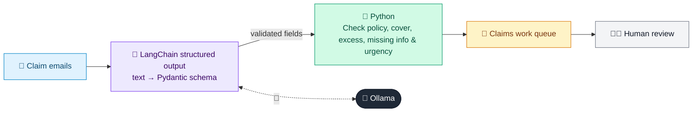

# 05 · FNOL Claim Intake

  

**Industry:** 🛡️ Insurance · **Category:** 🧾 Claims & Fraud

## 🛡️ The business problem (new to insurance? start here)

**In the business today:** Customers report losses by email, web form or phone. Claims staff read each one, find the policy, check it was in force and covers the loss, and pass it to the right team.

**Who does this work:** Claims intake and first-notice-of-loss (FNOL) teams.

**Why it's hard:** Reports arrive as free text with key facts scattered or missing. Emergencies, injuries and customers who need extra support must be spotted at once, not when the email reaches the top of the pile.

### Key terms
- **FNOL**: First Notice of Loss: the first report of a claim to the insurer.
- **Claims triage**: Sorting new claims by complexity and risk: fast-track simple ones, send complex ones to experts.
- **Vulnerable customer**: A customer whose circumstances (age, health, a crisis) mean they need extra care and support.
- **Bodily injury claim**: A claim for someone's injury, handled by a specialist team because it is costly and slow to settle.
- **Excess (deductible)**: The amount the customer pays towards each claim before the insurer pays the rest.
- **Subrogation**: Recovering what the insurer paid from a third party who caused the loss, e.g. the at-fault driver's insurer.

More terms: [Insurance Primer & glossary](../PRIMER.md#glossary)

---

## 🤖 What the AI does
Turns first-notice-of-loss emails into checked claims, routed to the right team with urgent cases first.

### How it works
Each email is first classified (motor accident, home damage, theft), then the details for that type are extracted into a small Pydantic schema; Python checks the policy was in force on the loss date and covers the cause, sets the excess, lists missing information and flags emergencies, injuries and customers who need extra support; an LLM chain writes the claims team's work queue.



<sub>🟦 data · 🟩 Python: maths & rules (auditable) · 🟪 AI: reasoning & writing · ⬛ local LLM · 🟨 result</sub>

## 💬 Sample conversation

A real recorded run on `qwen2.5:7b-instruct` (local, on a laptop, 22 s). Expand a step to see what happened
behind the answer. LLM wording changes from run to run; the numbers from Python stay the same.

> **👤 You:** Four new claims came in by email overnight. What are they, and what does the claims team need to do first?

<details><summary>🧾 Extracted · Maria Lopez</summary>

```json
{
  "claim_type": "motor_accident",
  "policy_number": "POL-1001",
  "loss_date": "12 Oct 2026",
  "third_party_registration": "KX19 ABC",
  "third_party_insurer": "Swift Insurance",
  "third_party_admitted_fault": true,
  "mentions_pain_or_injury": true,
  "vehicle_driveable": true
}
```

</details>

<details><summary>🧾 Extracted · Edith Harper</summary>

```json
{
  "claim_type": "home_damage",
  "policy_number": "POL-2002",
  "loss_date": "13 Oct 2026",
  "cause": "water_leak",
  "emergency": true,
  "customer_needs_extra_support": true
}
```

</details>

<details><summary>🧾 Extracted · Sam Okafor</summary>

```json
{
  "claim_type": "theft",
  "policy_number": "POL-3003",
  "loss_date": "5 Oct 2026",
  "items_stolen": "two bikes and a lawnmower",
  "estimated_value": 2300.0,
  "police_crime_reference": "None reported yet (padlock was cut)"
}
```

</details>

<details><summary>🧾 Extracted · Priya Shah</summary>

```json
{
  "claim_type": "home_damage",
  "policy_number": "POL-2002",
  "loss_date": "30 Sep 2026",
  "cause": "spill_or_drop",
  "emergency": false,
  "customer_needs_extra_support": false
}
```

</details>

<details><summary>🐍 Python · Validation</summary>

```json
[
  {
    "customer": "Maria Lopez",
    "policy": "POL-1001",
    "claim_type": "motor_accident",
    "loss_date": "2026-10-12",
    "reported_after_days": 1,
    "policy_in_force_on_loss_date": true,
    "cause": "accident",
    "covered": true,
    "excess": 300,
    "route": "Claims handler",
    "priority": "URGENT",
    "missing_information": null,
    "recovery_from_third_party": "Swift Insurance",
    "late_report": false,
    "actions": [
      "injury reported: pass to the bodily injury team",
      "excess to deduct: 300",
      "recover our costs from Swift Insurance (their driver admitted fault)"
    ]
  },
  {
    "customer": "Edith Harper",
    "policy": "POL-2002",
    "claim_type": "home_damage",
    "loss_date": "2026-10-13",
    "reported_after_days": 0,
    "policy_in_force_on_loss_date": true,
    "cause": "escape_of_water",
    "covered": true,
    "excess": 500,
    "route": "Claims handler",
    "priority": "URGENT",
    "missing_information": null,
    "recovery_from_third_party": null,
    "late_report": false,
    "actions": [
      "emergency: send an emergency plumber and electrician today",
      "customer needs extra support: phone them, don't email",
      "excess to deduct: 500"
    ]
  },
  {
    "customer": "Sam Okafor",
    "policy": "POL-3003",
    "claim_type": "theft",
    "loss_date": "2026-10-05",
    "reported_after_days": 8,
    "policy_in_force_on_loss_date": false,
    "cause": "theft",
    "covered": false,
    "excess": null,
    "route": "Coverage check: policy lapsed (not renewed), ended 2026-09-30, before the loss date",
    "priority": "normal",
    "missing_information": [
      "police crime reference (required for every theft claim)"
    ],
    "recovery_from_third_party": null,
    "late_report": true,
    "actions": [
      "ask the customer for the police crime reference (required for every theft claim)",
      "coverage check: policy lapsed (not renewed), ended 2026-09-30, before the loss date: handler to confirm before writing to the customer",
      "reported 8 days after the loss: note why on the file"
    ]
  },
  {
    "customer": "Priya Shah",
    "policy": "POL-2002",
    "claim_type": "home_damage",
    "loss_date": "2026-09-30",
    "reported_after_days": 13,
    "policy_in_force_on_loss_date": true,
    "cause": "accidental_damage",
    "covered": false,
    "excess": null,
    "route": "Coverage check: 'accidental_damage' is not covered by this home buildings & contents policy",
    "priority": "normal",
    "missing_information": null,
    "recovery_from_third_party": null,
    "late_report": true,
    "actions": [
      "coverage check: 'accidental_damage' is not covered by this home buildings & contents policy: handler to confirm before writing to the customer",
      "reported 13 days after the loss: note why on the file"
    ]
  }
]
```

</details>

**🦙 Ollama:**

**URGENT · Maria Lopez (POL-1001)**: On 12 Oct 2026 at 8am, another car hit her car at High St and Mill Lane. The other driver admitted fault. Her neck is sore, car driveable but boot won't close.

- injury reported: pass to the bodily injury team
- excess to deduct: 300
- recover our costs from Swift Insurance (their driver admitted fault)

**URGENT · Edith Harper (POL-2002)**: Water from upstairs bathroom ceiling flooded her kitchen on 13 Oct 2026. Turned off water but ceiling is sagging and light fitting is dripping. 82, lives alone.

- emergency: send an emergency plumber and electrician today
- customer needs extra support: phone them, don't email
- excess to deduct: 500

**normal · Sam Okafor (POL-3003)**: Someone broke into his garden shed on 5 Oct 2026, took two bikes and a lawnmower. The padlock was cut. Not reported to the police yet.

- ask the customer for the police crime reference (required for every theft claim)
- coverage check: policy lapsed (not renewed), ended 2026-09-30, before the loss date: handler to confirm before writing to the customer
- reported 8 days after the loss: note why on the file

**normal · Priya Shah (POL-2002)**: Son knocked over a tin of paint on 30 Sep 2026, damaged new living room carpet. Carpet cost 1,400.

- coverage check: 'accidental_damage' is not covered by this home buildings & contents policy: handler to confirm before writing to the customer
- reported 13 days after the loss: note why on the file


## Run
```bash
# from the repo root, with Ollama running
python 03_insurance/05_fnol_claim_intake/app.py
```

## Customize
- Replace the sample data at the top of `app.py` with your own data source (CSV, database, API).
- Tune thresholds and rules in the Python functions. These are the auditable part of the solution.
- Change the model with `OLLAMA_MODEL` (see the root [README](../../README.md#-model-recommendations)).

> Sample data is fictional; calculations are simplified for learning.

[⬅ Back to Insurance use cases](../README.md#-use-cases) · [All industries](../../README.md)
