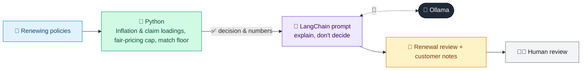

# 06 · Renewal Pricing & Retention Advisor

  

**Industry:** 🛡️ Insurance · **Category:** 📝 Underwriting & Pricing

## 🛡️ The business problem (new to insurance? start here)

**In the business today:** Each month, the pricing team sets the renewal price for policies coming up for renewal and the customer gets a renewal letter.

**Who does this work:** Pricing analysts and retention teams.

**Why it's hard:** Prices must cover rising claims costs, but a renewing customer can't be charged more than a new one. Loyal customers deserve a clear reason when their price changes.

### Key terms
- **Renewal**: Offering an existing customer a new policy year, usually at a new price.
- **Technical price**: The price that covers the expected claims and costs for a risk. Below it, the policy is expected to lose money.
- **Fair-pricing rule**: A rule (e.g. in the UK since 2022) that renewing customers can't be charged more than a new customer for the same cover.
- **Price walking**: Raising prices for loyal customers each year because they rarely shop around. Banned by fair-pricing rules.
- **Premium**: The price a customer pays for an insurance policy, usually yearly or monthly.

More terms: [Insurance Primer & glossary](../PRIMER.md#glossary)

---

## 🤖 What the AI does
Prices motor renewals fairly and explains to each customer why their price went up or down.

### How it works
Python applies claims inflation and claim loadings, raises prices to the cost of the risk, caps every renewal at the price a new customer would pay (fair-pricing rule) and matches a competitor quote only down to a margin floor; an LLM chain writes the pricing review and a plain-English note per customer.



<sub>🟦 data · 🟩 Python: maths & rules (auditable) · 🟪 AI: reasoning & writing · ⬛ local LLM · 🟨 result</sub>

## 💬 Sample conversation

A real recorded run on `qwen2.5:7b-instruct` (local, on a laptop, 14 s). Expand a step to see what happened
behind the answer. LLM wording changes from run to run; the numbers from Python stay the same.

> **👤 You:** Price next month's motor renewals. Who gets an increase, and are we treating loyal customers fairly?

<details><summary>🐍 Python · Renewal prices</summary>

```json
[
  {
    "id": "RN-01",
    "years_with_us": 8,
    "last_premium": 540,
    "renewal_premium": 505,
    "change": "-6.5%",
    "change_amount": -35,
    "internal_price_steps": [
      "last premium 540",
      "+7% claims inflation -> 577.80",
      "capped at the new-customer price 505 (fair-pricing rule)"
    ],
    "margin_over_technical_price": 75,
    "flags": null,
    "reasons_for_customer": [
      "repair and parts costs rose about 7% this year",
      "we never charge a renewing customer more than a new customer for the same cover"
    ]
  },
  {
    "id": "RN-02",
    "years_with_us": 2,
    "last_premium": 610,
    "renewal_premium": 815.88,
    "change": "+33.7%",
    "change_amount": 205.88,
    "internal_price_steps": [
      "last premium 610",
      "+7% claims inflation -> 652.70",
      "+25% for 1 at-fault claim -> 815.88"
    ],
    "margin_over_technical_price": 125.88,
    "flags": [
      "Large increase: call the customer and offer options (higher voluntary excess, fewer add-ons)"
    ],
    "reasons_for_customer": [
      "repair and parts costs rose about 7% this year",
      "the at-fault claim on the policy last year"
    ]
  },
  {
    "id": "RN-03",
    "years_with_us": 4,
    "last_premium": 480,
    "renewal_premium": 470,
    "change": "-2.1%",
    "change_amount": -10,
    "internal_price_steps": [
      "last premium 480",
      "+7% claims inflation -> 513.60",
      "price match to 470 (competitor quote 470; our floor would be 420)"
    ],
    "margin_over_technical_price": 70,
    "flags": null,
    "reasons_for_customer": [
      "repair and parts costs rose about 7% this year",
      "we matched the 470 quote you told us about"
    ]
  },
  {
    "id": "RN-04",
    "years_with_us": 3,
    "last_premium": 395,
    "renewal_premium": 445,
    "change": "+12.7%",
    "change_amount": 50,
    "internal_price_steps": [
      "last premium 395",
      "+7% claims inflation -> 422.65",
      "raised to the technical price -> 455",
      "capped at the new-customer price 445 (fair-pricing rule)"
    ],
    "margin_over_technical_price": -10,
    "flags": [
      "Below technical price (455) but capped by the fair-pricing rule: refer to the pricing team to review new-customer rates, which are too low for this risk"
    ],
    "reasons_for_customer": [
      "repair and parts costs rose about 7% this year",
      "the cost of insuring cars like yours in your area has gone up",
      "we never charge a renewing customer more than a new customer for the same cover"
    ]
  }
]
```

</details>

**🦙 Ollama:**

### Renewal Review for the Pricing Manager

| ID | Last Premium | Renewal Premium | Change | Why |
|----|--------------|-----------------|--------|-----|
| RN-01 | 540 | 505 | -6.5% | Repair and parts costs rose about 7% this year. We never charge a renewing customer more than a new customer for the same cover. |
| RN-02 | 610 | 815.88 | +33.7% | Repair and parts costs rose about 7% this year. The at-fault claim on the policy last year. |
| RN-03 | 480 | 470 | -2.1% | Repair and parts costs rose about 7% this year. We matched the 470 quote you told us about. |
| RN-04 | 395 | 445 | +12.7% | Repair and parts costs rose about 7% this year. The cost of insuring cars like yours in your area has gone up. We never charge a renewing customer more than a new customer for the same cover. |

### Flags
- Large increase: call the customer and offer options (higher voluntary excess, fewer add-ons) (RN-02)
- Below technical price (455) but capped by the fair-pricing rule: refer to the pricing team to review new-customer rates, which are too low for this risk (RN-04)

### Customer Notes
- **RN-01**: Your renewal premium has decreased by 6.5% to $505. This is due to the 7% increase in repair and parts costs, but we ensure that renewing customers are not charged more than new customers for the same coverage.
- **RN-02**: Your renewal premium has increased by 33.7% to $815.88. This is because of the 7% increase in repair and parts costs and the at-fault claim on your policy last year. We understand this is a significant increase and would be happy to discuss options with you.
- **RN-03**: Your renewal premium has decreased by 2.1% to $470. This is due to the 7% increase in repair and parts costs, and we matched the 470 quote you provided us with.
- **RN-04**: Your renewal premium has increased by 12.7% to $445. This is due to the 7% increase in repair and parts costs and the rising cost of insuring cars like yours in your area. We ensure that renewing customers are not charged more than new customers for the same coverage.


## Run
```bash
# from the repo root, with Ollama running
python 03_insurance/06_renewal_pricing_advisor/app.py
```

## Customize
- Replace the sample data at the top of `app.py` with your own data source (CSV, database, API).
- Tune thresholds and rules in the Python functions. These are the auditable part of the solution.
- Change the model with `OLLAMA_MODEL` (see the root [README](../../README.md#-model-recommendations)).

> Sample data is fictional; calculations are simplified for learning.

[⬅ Back to Insurance use cases](../README.md#-use-cases) · [All industries](../../README.md)
