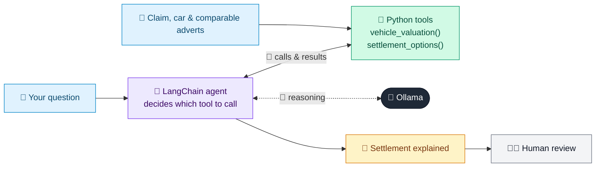

# 07 · Motor Total Loss Settlement Agent

  

**Industry:** 🛡️ Insurance · **Category:** 🧾 Claims & Fraud

## 🛡️ The business problem (new to insurance? start here)

**In the business today:** When a car is too damaged to repair economically, the claims handler values it, agrees the settlement with the customer and pays any finance company first.

**Who does this work:** Motor claims handlers and total loss teams.

**Why it's hard:** Customers are upset and often think the valuation is too low. The settlement must be clearly explained: how the value was set, the excess, the finance, and the option to keep the car.

### Key terms
- **Total loss (write-off)**: When repairing the car would cost too much compared with its value, so the insurer pays out its value instead.
- **Market value**: What it would cost to buy the same car (make, model, age, mileage) just before the loss.
- **Salvage**: The damaged car's remaining value, e.g. for parts. The insurer sells it unless the customer keeps it.
- **Write-off category**: How badly a written-off car is damaged: Category S (structural) and N (non-structural) can be repaired; A and B must be scrapped.
- **Excess (deductible)**: The amount the customer pays towards each claim before the insurer pays the rest.

More terms: [Insurance Primer & glossary](../PRIMER.md#glossary)

---

## 🤖 What the AI does
Explains a write-off settlement: what the car is worth, why it's a write-off and who gets paid what.

### How it works
Tools value the car from mileage-adjusted comparable adverts, apply the 60% repair-cost write-off rule and category, and split the settlement between the finance company and the customer, with or without keeping the car; the agent explains it and copies every number from the tools.



<sub>🟦 data · 🟩 Python: maths & rules (auditable) · 🟪 AI: reasoning & writing · ⬛ local LLM · 🟨 result</sub>

## 💬 Sample conversation

A real recorded run on `qwen2.5:7b-instruct` (local, on a laptop, 16 s). Expand a step to see what happened
behind the answer. LLM wording changes from run to run; the numbers from Python stay the same.

> **👤 You:** My car was written off in the crash last week (claim CL-7731). How much will I get, and could I keep the car and get it repaired myself instead?

<details><summary>🔧 Tool calls</summary>

```text
vehicle_valuation(claim_id='CL-7731') -> {"vehicle": "2021 Volkswagen Golf 1.5 TSI Life", "mileage": 38000, "market_value": 15820, "comparables": ["dealer advert, 31,000 miles: 16,450, adjusted for mileage to 16,170", "dealer advert, 36,500 miles: 15,990, adjusted for mileage to 15,930", "private sale, 42,000 miles: 15,200, adjusted for mileage to 15,360"], "repair_estimate": 11800, "repair_cost_share_of_value": "75%", "decision": "TOTAL
settlement_options(claim_id='CL-7731') -> {"market_value": 15820, "excess": 350, "salvage_value": 3164, "finance_company": "Northgate Finance", "option_1_insurer_keeps_car": {"calculation": "15,820 - 350 excess", "excess_deducted": 350, "total_settlement": 15470, "paid_to_finance_company": 6200, "paid_to_customer": 9270, "still_owed_to_lender": 0}, "option_2_customer_keeps_car": {"calculation": "15,820 - 350 excess - 3,164 salvage value",
```

</details>

**🦙 Ollama:**

Hello, I understand this must be a difficult time for you. Let's go through the details of your claim, CL-7731, for your 2021 Volkswagen Golf 1.5 TSI Life.

### Market Value and How It Was Set
The market value of your car, based on comparable adverts, is **15,820**. Here are the details of the comparables used:
- A dealer advert with 31,000 miles, adjusted to 16,170.
- A dealer advert with 36,500 miles, adjusted to 15,930.
- A private sale with 42,000 miles, adjusted to 15,360.

### Why the Car is a Write-Off and Its Write-Off Category
Your car is considered a write-off due to the significant structural damage, which makes it uneconomical to repair. The write-off category is **Category S**, meaning it can be professionally repaired and put back on the road.

### Settlement Options
There are two options for settling your claim:

1. **Insurer Keeps the Car:**
   - **Calculation:** 15,820 - 350 (excess) = 15,470
   - **Excess Deducted:** 350
   - **Total Settlement:** 15,470
   - **Paid to Finance Company (Northgate Finance):** 6,200
   - **Paid to Customer:** 9,270

2. **Customer Keeps the Car:**
   - **Calculation:** 15,820 - 350 (excess) - 3,164 (salvage value) = 12,306
   - **Excess Deducted:** 350
   - **Total Settlement:** 12,306
   - **Paid to Finance Company (Northgate Finance):** 6,200
   - **Paid to Customer:** 6,106
   - **Still Owed to Lender:** 0

### Documents Needed
To proceed, please provide the following documents:
- Vehicle registration document (logbook)
- Both keys
- Finance settlement letter
- Service history

### What to Do If You Disagree with the Value
If you believe the value is incorrect, please send us adverts for the same model, year, and mileage, and we will review it.

### Next Steps
The payment will be made within 5 working days of receiving the documents. If you have any questions or need further assistance, please don't hesitate to contact us.

I hope this helps, and I'm here to support you through this process.


## Run
```bash
# from the repo root, with Ollama running
python 03_insurance/07_total_loss_settlement/app.py
```

## Customize
- Replace the sample data at the top of `app.py` with your own data source (CSV, database, API).
- Tune thresholds and rules in the Python functions. These are the auditable part of the solution.
- Change the model with `OLLAMA_MODEL` (see the root [README](../../README.md#-model-recommendations)).

> Sample data is fictional; calculations are simplified for learning.

[⬅ Back to Insurance use cases](../README.md#-use-cases) · [All industries](../../README.md)
