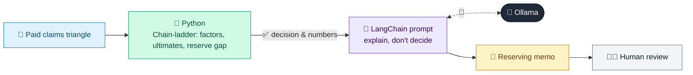

# 08 · Claims Reserving Analyst (Chain-Ladder)

  

**Industry:** 🛡️ Insurance · **Category:** 📊 Actuarial & Risk

## 🛡️ The business problem (new to insurance? start here)

**In the business today:** Every quarter, actuaries estimate how much the insurer will still pay on claims that have already happened, and check the reserves on the balance sheet are enough.

**Who does this work:** Reserving actuaries, the finance team and the reserving committee.

**Why it's hard:** Claims take years to settle and some haven't been reported yet. Too little in reserve overstates profit; too much ties up capital. The newest years are the most uncertain.

### Key terms
- **Claims reserve**: Money set aside today for claims that will be paid in the future.
- **IBNR**: Incurred But Not Reported: claims that have happened but the insurer hasn't heard about yet.
- **Accident year**: The year in which the losses happened, however many years the claims take to pay.
- **Claims triangle**: A table of claims paid by accident year (rows) and years since (columns), used to see how claims build up over time.
- **Chain-ladder**: The standard reserving method: assumes claims will keep building up the way they did in past years.
- **Development factor**: How much claims paid for an accident year grow from one year to the next, e.g. 1.25 = +25%.
- **Ultimate claims**: The total an accident year's claims will cost once every claim is paid.
- **Loss ratio**: Claims divided by earned premium. Above about 75%, there is usually little left after costs.
- **Earned premium**: The part of premiums that covers time already passed, matched against that period's claims.

More terms: [Insurance Primer & glossary](../PRIMER.md#glossary)

---

## 🤖 What the AI does
Estimates how much money to hold for future claim payments and whether today's reserves are enough.

### How it works
Python runs the chain-ladder method on a paid claims triangle (age-to-age factors, ultimate claims, reserve needed per accident year) and compares it with booked reserves and the target loss ratio; an LLM chain writes the reserving memo with its caveats.



<sub>🟦 data · 🟩 Python: maths & rules (auditable) · 🟪 AI: reasoning & writing · ⬛ local LLM · 🟨 result</sub>

## 💬 Sample conversation

A real recorded run on `qwen2.5:7b-instruct` (local, on a laptop, 14 s). Expand a step to see what happened
behind the answer. LLM wording changes from run to run; the numbers from Python stay the same.

> **👤 You:** Are our motor claims reserves enough at year-end? Which accident years need more?

<details><summary>🐍 Python · Development factors</summary>

```json
[
  {
    "from_year": 1,
    "to_year": 2,
    "age_to_age_factor": 1.818,
    "factor_to_ultimate": 2.507
  },
  {
    "from_year": 2,
    "to_year": 3,
    "age_to_age_factor": 1.252,
    "factor_to_ultimate": 1.379
  },
  {
    "from_year": 3,
    "to_year": 4,
    "age_to_age_factor": 1.08,
    "factor_to_ultimate": 1.102
  },
  {
    "from_year": 4,
    "to_year": 5,
    "age_to_age_factor": 1.02,
    "factor_to_ultimate": 1.02
  }
]
```

</details>

<details><summary>🐍 Python · Reserves by accident year</summary>

```json
{
  "accident_years": [
    {
      "accident_year": 2021,
      "years_developed": 5,
      "paid_to_date": 4905000,
      "ultimate_claims": 4905000,
      "reserve_needed": 0,
      "reserve_booked": 0,
      "shortfall": 0,
      "surplus": 0,
      "ultimate_loss_ratio": "71.1%",
      "loss_ratio_above_target": false
    },
    {
      "accident_year": 2022,
      "years_developed": 4,
      "paid_to_date": 5290000,
      "ultimate_claims": 5394480,
      "reserve_needed": 104480,
      "reserve_booked": 105000,
      "shortfall": 0,
      "surplus": 520,
      "ultimate_loss_ratio": "74.9%",
      "loss_ratio_above_target": false
    },
    {
      "accident_year": 2023,
      "years_developed": 3,
      "paid_to_date": 5400000,
      "ultimate_claims": 5948363,
      "reserve_needed": 548363,
      "reserve_booked": 600000,
      "shortfall": 0,
      "surplus": 51637,
      "ultimate_loss_ratio": "78.3%",
      "loss_ratio_above_target": true
    },
    {
      "accident_year": 2024,
      "years_developed": 2,
      "paid_to_date": 5180000,
      "ultimate_claims": 7144637,
      "reserve_needed": 1964637,
      "reserve_booked": 1750000,
      "shortfall": 214637,
      "surplus": 0,
      "ultimate_loss_ratio": "88.2%",
      "loss_ratio_above_target": true
    },
    {
      "accident_year": 2025,
      "years_developed": 1,
      "paid_to_date": 3250000,
      "ultimate_claims": 8148506,
      "reserve_needed": 4898506,
      "reserve_booked": 4300000,
      "shortfall": 598506,
      "surplus": 0,
      "ultimate_loss_ratio": "93.7%",
      "loss_ratio_above_target": true
    }
  ],
  "total": {
    "reserve_needed": 7515986,
    "reserve_booked": 6755000,
    "net_reserve_increase_needed": 760986,
    "years_with_shortfall": [
      2024,
      2025
    ],
    "target_loss_ratio": "75%",
    "most_uncertain_year": "2025 (only 1 year of payments, so its estimate rests most on the development factors)"
  }
}
```

</details>

**🦙 Ollama:**

**Reserving Memo**

**1. Overall Position:**
- **Reserve Needed vs Booked:** The total reserve needed is $7,515,986, while the reserves booked are $6,755,000, resulting in a net increase needed of $760,986.
- **Years with Shortfall:** 2024 and 2025 have shortfalls of $214,637 and $598,506, respectively.

**2. Accident Year Analysis:**
- **2021:** No reserve needed, as the ultimate claims equal the paid-to-date claims. Loss ratio is 71.1%, below the target of 75%.
- **2022:** Reserve needed is $104,480, with a surplus of $520. The loss ratio is 74.9%, below the target.
- **2023:** Reserve needed is $548,363, with a surplus of $51,637. The loss ratio is 78.3%, above the target.
- **2024:** Reserve needed is $1,964,637, with a shortfall of $214,637. The loss ratio is 88.2%, significantly above the target.
- **2025:** Reserve needed is $4,898,506, with a shortfall of $598,506. The loss ratio is 93.7%, well above the target.

**3. Trend Suggestion:**
- The trend suggests rising claims costs, as the loss ratios have been increasing over the years, with 2024 and 2025 showing particularly high loss ratios.

**4. Caveats:**
- The chain-ladder method assumes past payment patterns will repeat, which may not hold in the future. The most recent year (2025) is the least certain due to only one year of payments, so a cross-check with the Bornhuetter-Ferguson method is recommended.

**Recommendation:**
Given the significant shortfalls in 2024 and 2025, and the rising loss ratios, it is prudent to increase reserves by $760,986. A cross-check with the Bornhuetter-Ferguson method is recommended to ensure the accuracy of the reserve estimates.


## Run
```bash
# from the repo root, with Ollama running
python 03_insurance/08_claims_reserving_analyst/app.py
```

## Customize
- Replace the sample data at the top of `app.py` with your own data source (CSV, database, API).
- Tune thresholds and rules in the Python functions. These are the auditable part of the solution.
- Change the model with `OLLAMA_MODEL` (see the root [README](../../README.md#-model-recommendations)).

> Sample data is fictional; calculations are simplified for learning.

[⬅ Back to Insurance use cases](../README.md#-use-cases) · [All industries](../../README.md)
