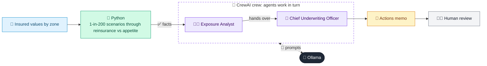

# 09 · Catastrophe Exposure Monitor

  

**Industry:** 🛡️ Insurance · **Category:** 📊 Actuarial & Risk

## 🛡️ The business problem (new to insurance? start here)

**In the business today:** Before each storm season, the exposure team checks how much the insurer could lose from a severe storm or flood, after reinsurance, against the board's risk appetite.

**Who does this work:** Catastrophe risk analysts, the chief underwriting officer and the board risk committee.

**Why it's hard:** Growth in cheap, high-hazard areas quietly piles up exposure. One event hits thousands of homes at once, and a loss bigger than the reinsurance falls straight on the insurer's capital.

### Key terms
- **Catastrophe (cat) event**: One event, such as a storm or flood, that causes many claims at once.
- **Total insured value (TIV)**: The sum of all the sums insured in an area: the most the insurer could lose there.
- **1-in-200 event**: An event so severe it is expected once in 200 years (0.5% a year). Capital rules require surviving one.
- **Reinsurance**: Insurance for insurers: another company pays part of very large losses in exchange for a premium.
- **Excess of loss (XL)**: Reinsurance that pays the part of an event's loss above a retention, up to a limit, e.g. 100m excess of 25m.
- **Accumulation**: Too much insured value concentrated in one area, so a single event hits many policies at once.
- **Risk appetite**: The types and amount of risk the insurer is willing to accept, set by the board.

More terms: [Insurance Primer & glossary](../PRIMER.md#glossary)

---

## 🤖 What the AI does
Checks whether a 1-in-200 storm or flood would cost more than the board's risk appetite, and what to change.

### How it works
Python totals insured values by zone against appetite limits, runs 1-in-200 windstorm and flood scenarios through the reinsurance programme and works out the net loss and any extra cover needed; an Exposure Analyst agent explains the drivers and a Chief Underwriting Officer agent writes the actions memo.



<sub>🟦 data · 🟩 Python: maths & rules (auditable) · 🟪 AI: reasoning & writing · ⬛ local LLM · 🟨 result</sub>

## 💬 Sample conversation

A real recorded run on `qwen2.5:7b-instruct` (local, on a laptop, 40 s). Expand a step to see what happened
behind the answer. LLM wording changes from run to run; the numbers from Python stay the same.

> **👤 You:** Is our home insurance catastrophe exposure within appetite? What should we change before the winter storm season?

<details><summary>🐍 Python · Exposure & scenarios</summary>

```json
{
  "zones": [
    {
      "zone": "Z1 Coastal East",
      "main_hazard": "windstorm and storm surge",
      "policies": 18000,
      "tiv": "5.40bn",
      "appetite_limit": "5.00bn",
      "limit_used": "108%",
      "over_limit_by": "400.0m",
      "growth_12m": "+6%",
      "windstorm_loss": "81.0m",
      "flood_loss": "21.6m"
    },
    {
      "zone": "Z2 River Valley",
      "main_hazard": "river flood",
      "policies": 9500,
      "tiv": "2.85bn",
      "appetite_limit": "2.50bn",
      "limit_used": "114%",
      "over_limit_by": "350.0m",
      "growth_12m": "+11%",
      "windstorm_loss": "11.4m",
      "flood_loss": "62.7m"
    },
    {
      "zone": "Z3 Inland Urban",
      "main_hazard": "surface water flooding",
      "policies": 42000,
      "tiv": "10.50bn",
      "appetite_limit": "14.00bn",
      "limit_used": "75%",
      "over_limit_by": null,
      "growth_12m": "+3%",
      "windstorm_loss": "31.5m",
      "flood_loss": "21.0m"
    },
    {
      "zone": "Z4 Upland Rural",
      "main_hazard": "windstorm",
      "policies": 6000,
      "tiv": "1.50bn",
      "appetite_limit": "2.50bn",
      "limit_used": "60%",
      "over_limit_by": null,
      "growth_12m": "+1%",
      "windstorm_loss": "12.0m",
      "flood_loss": "1.5m"
    }
  ],
  "scenarios": [
    {
      "scenario": "1-in-200 windstorm",
      "gross_loss": "135.9m",
      "reinsurance_recovery": "100.0m",
      "net_loss": "35.9m",
      "net_loss_share_of_capital": "9.0%",
      "appetite": "30.0m",
      "within_appetite": false,
      "reinsurance_exhausted_by": "10.9m",
      "extra_reinsurance_limit_needed": "5.9m",
      "biggest_zone": "Z1 Coastal East (60% of the loss)"
    },
    {
      "scenario": "1-in-200 flood",
      "gross_loss": "106.8m",
      "reinsurance_recovery": "81.8m",
      "net_loss": "25.0m",
      "net_loss_share_of_capital": "6.2%",
      "appetite": "30.0m",
      "within_appetite": true,
      "reinsurance_exhausted_by": null,
      "extra_reinsurance_limit_needed": null,
      "biggest_zone": "Z2 River Valley (59% of the loss)"
    }
  ],
  "reinsurance": "100.0m excess of 25.0m per event",
  "capital": "400.0m"
}
```

</details>

<details><summary>🧑‍💼 Exposure Analyst (agent)</summary>

### Findings: By Scenario and by Zone

#### 1-in-200 Windstorm Scenario

- **Gross Loss:** $135.9 million
- **Reinsurance Recovery:** $100.0 million
- **Net Loss:** $35.9 million
- **Net Loss as a Share of Capital:** 9.0%
- **Appetite:** $30.0 million
- **Within Appetite:** No
- **Reinsurance Exhausted By:** $10.9 million
- **Extra Reinsurance Limit Needed:** $5.9 million
- **Biggest Zone:** Z1 Coastal East (60% of the loss)

**Explanation:**
- **Z1 Coastal East:** This zone is the primary driver of the 1-in-200 windstorm loss, contributing 60% of the total loss. The zone has a significant number of policies (18,000) and a high Total Insured Value (TIV) of $5.4 billion. The limit used is 108%, indicating that the appetite limit of $5.0 billion is exceeded by $400 million. The recent growth of 6% over the last 12 months has contributed to this exposure, as the number of policies and TIV have increased.
- **Z2 River Valley:** This zone contributes 22% of the total loss, with a gross loss of $29.4 million. The limit used is 114%, indicating an over-limit by $350 million. The recent growth of 11% over the last 12 months has also contributed to this exposure.
- **Z3 Inland Urban:** This zone contributes 18% of the total loss, with a gross loss of $24.4 million. The limit used is 75%, indicating that the appetite limit of $14.0 billion is not exceeded. The recent growth of 3% over the last 12 months has contributed to this exposure.
- **Z4 Upland Rural:** This zone contributes 10% of the total loss, with a gross loss of $13.5 million. The limit used is 60%, indicating that the appetite limit of $2.5 billion is not exceeded. The recent growth of 1% over the last 12 months has contributed to this exposure.

#### 1-in-200 Flood Scenario

- **Gross Loss:** $106.8 million
- **Reinsurance Recovery:** $81.8 million
- **Net Loss:** $25.0 million
- **Net Loss as a Share of Capital:** 6.2%
- **Appetite:** $30.0 million
- **Within Appetite:** Yes
- **Reinsurance Exhausted By:** None
- **Extra Reinsurance Limit Needed:** None
- **Biggest Zone:** Z2 River Valley (59% of the loss)

**Explanation:**
- **Z2 River Valley:** This zone is the primary driver of the 1-in-200 flood loss, contributing 59% of the total loss. The zone has a significant number of policies (9,500) and a TIV of $2.85 billion. The limit used is 114%, indicating an over-limit by $350 million. The recent growth of 11% over the last 12 months has contributed to this exposure.
- **Z1 Coastal East:** This zone contributes 25% of the total loss, with a gross loss of $26.7 million. The limit used is 108%, indicating an over-limit by $400 million. The recent growth of 6% over the last 12 months has contributed to this exposure.
- **Z3 Inland Urban:** This zone contributes 13% of the total loss, with a gross loss of $13.9 million. The limit used is 75%, indicating that the appetite limit of $14.0 billion is not exceeded. The recent growth of 3% over the last 12 months has contributed to this exposure.
- **Z4 Upland Rural:** This zone contributes 3% of the total loss, with a gross loss of $3.2 million. The limit used is 60%, indicating that the appetite limit of $2.5 billion is not exceeded. The recent growth of 1% over the last 12 months has contributed to this exposure.

### Summary

- **Over Appetite Limits:**
  - **Z1 Coastal East:** Over by $400 million
  - **Z2 River Valley:** Over by $350 million

- **Recent Growth Contribution:**
  - **Z1 Coastal East:** 6% growth over the last 12 months
  - **Z2 River Valley:** 11% growth over the last 12 months
  - **Z3 Inland Urban:** 3% growth over the last 12 months
  - **Z4 Upland Rural:** 1% growth over the last 12 months

- **Reinsurance and Capital:**
  - **Reinsurance:** $100.0 million excess of $25.0 million per event
  - **Capital:** $400.0 million

This analysis highlights the key zones and perils driving the 1-in-200 losses, the zones over their appetite limits, and the impact of recent growth on the exposure.

</details>

**🦙 Ollama:**

### Memo

By Scenario and by Zone, the 1-in-200 windstorm and flood scenarios reveal significant exposure that exceeds appetite limits. The Z1 Coastal East and Z2 River Valley zones are primary drivers of the losses, contributing 60% and 59% of the total loss, respectively. The Z1 Coastal East zone is over its appetite limit by $400 million, while the Z2 River Valley zone is over its limit by $350 million. The recent growth in both zones has contributed to this exposure.

**Actions for Z1 Coastal East:**
1. Implement a price increase for new business to reflect the increased risk.
2. Require roof and window standards at renewal to enhance resilience against windstorms.
3. Slow new business in the zone to reduce exposure.

**Actions for Z2 River Valley:**
1. Price for the flood risk to reflect the increased exposure.
2. Require flood resilience measures at renewal.
3. Slow new business in the zone to reduce exposure.

**Reinsurance Action:**
For the 1-in-200 windstorm scenario, the reinsurance limit has been exhausted by $10.9 million, and an additional $5.9 million in extra reinsurance is needed. For the 1-in-200 flood scenario, the reinsurance limit has not been exhausted, and no additional reinsurance is required.

**Monthly Monitoring:**
- Monitor the number of policies and TIV in the Z1 Coastal East and Z2 River Valley zones.
- Track the reinsurance recoveries and ensure they align with the expected recoveries.
- Review the effectiveness of the implemented actions to ensure they are reducing exposure within appetite limits.

This approach will help manage the exposure and ensure the company's capital is protected without abandoning customers.


## Run
```bash
# from the repo root, with Ollama running
python 03_insurance/09_cat_exposure_monitor/app.py
```

## Customize
- Replace the sample data at the top of `app.py` with your own data source (CSV, database, API).
- Tune thresholds and rules in the Python functions. These are the auditable part of the solution.
- Change the model with `OLLAMA_MODEL` (see the root [README](../../README.md#-model-recommendations)).

> Sample data is fictional; calculations are simplified for learning.

[⬅ Back to Insurance use cases](../README.md#-use-cases) · [All industries](../../README.md)
