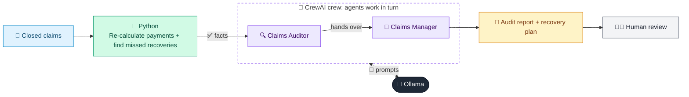

# 10 · Claims Leakage Auditor

  

**Industry:** 🛡️ Insurance · **Category:** 🧾 Claims & Fraud

## 🛡️ The business problem (new to insurance? start here)

**In the business today:** Claims quality teams re-check a sample of closed claims to find money paid that shouldn't have been, and fix the cause.

**Who does this work:** Claims auditors, claims managers and team leaders.

**Why it's hard:** Small mistakes repeat across thousands of claims: an excess not taken, an invoice paid twice, a third party nobody claimed from. Fixing the process matters more than blaming people.

### Key terms
- **Claims leakage**: Money paid on claims that should not have been, through mistakes or missed recoveries rather than fraud.
- **Wear and tear (betterment)**: A deduction for an old item's age when the policy pays its value, so the customer isn't better off than before.
- **Subrogation**: Recovering what the insurer paid from a third party who caused the loss, e.g. the at-fault driver's insurer.
- **Excess (deductible)**: The amount the customer pays towards each claim before the insurer pays the rest.

More terms: [Insurance Primer & glossary](../PRIMER.md#glossary)

---

## 🤖 What the AI does
Re-checks closed claims for overpayments and missed recoveries, and plans how to recover money and fix the process.

### How it works
Python re-calculates what each claim should have paid (excess, approved repair cost, wear and tear, duplicate invoices) and finds at-fault third parties nobody recovered from; a Claims Auditor agent explains the root causes and a Claims Manager agent writes the recovery list and process fixes.



<sub>🟦 data · 🟩 Python: maths & rules (auditable) · 🟪 AI: reasoning & writing · ⬛ local LLM · 🟨 result</sub>

## 💬 Sample conversation

A real recorded run on `qwen2.5:7b-instruct` (local, on a laptop, 26 s). Expand a step to see what happened
behind the answer. LLM wording changes from run to run; the numbers from Python stay the same.

> **👤 You:** Audit last month's closed claims. Where did we overpay, and what can we recover?

<details><summary>🐍 Python · Audit checks</summary>

```json
{
  "findings": [
    {
      "claim": "C-101",
      "team": "Home",
      "paid": 3250,
      "should_have_paid": 3250,
      "overpaid": 0,
      "missed_recovery": 0,
      "issues": [
        "none"
      ]
    },
    {
      "claim": "C-102",
      "team": "Home",
      "paid": 2600,
      "should_have_paid": 2100,
      "overpaid": 500,
      "missed_recovery": 0,
      "issues": [
        "excess not deducted: excess of 500 not deducted"
      ]
    },
    {
      "claim": "C-103",
      "team": "Motor",
      "paid": 4750,
      "should_have_paid": 3800,
      "overpaid": 950,
      "missed_recovery": 0,
      "issues": [
        "repair overrun: invoice 5,050 is 23% over the approved 4,100 with no extra approval"
      ]
    },
    {
      "claim": "C-104",
      "team": "Home",
      "paid": 1550,
      "should_have_paid": 650,
      "overpaid": 900,
      "missed_recovery": 0,
      "issues": [
        "wear and tear not deducted: wear-and-tear deduction of 900 not applied (paid new for old)"
      ]
    },
    {
      "claim": "C-105",
      "team": "Motor",
      "paid": 6400,
      "should_have_paid": 6400,
      "overpaid": 0,
      "missed_recovery": 6400,
      "issues": [
        "missed recovery: third party at fault but no recovery started"
      ]
    },
    {
      "claim": "C-106",
      "team": "Motor",
      "paid": 1200,
      "should_have_paid": 1200,
      "overpaid": 0,
      "missed_recovery": 0,
      "issues": [
        "none"
      ]
    },
    {
      "claim": "C-107",
      "team": "Motor",
      "paid": 1200,
      "should_have_paid": 0,
      "overpaid": 1200,
      "missed_recovery": 0,
      "issues": [
        "duplicate invoice: invoice INV-7802 was already paid on C-106"
      ]
    },
    {
      "claim": "C-108",
      "team": "Home",
      "paid": 5100,
      "should_have_paid": 5100,
      "overpaid": 0,
      "missed_recovery": 0,
      "issues": [
        "none"
      ]
    }
  ],
  "summary": {
    "claims_reviewed": 8,
    "total_paid": 26050,
    "total_overpaid": 3550,
    "overpaid_share_of_paid": "13.6%",
    "total_missed_recovery": 6400,
    "claims_with_issues": 5,
    "issues_by_type": {
      "excess not deducted": 1,
      "repair overrun": 1,
      "wear and tear not deducted": 1,
      "missed recovery": 1,
      "duplicate invoice": 1
    },
    "overpaid_plus_missed_recovery_by_team": {
      "Home": 1400,
      "Motor": 8550
    },
    "recover_now": [
      "C-103 (repair overrun): ask the repairer to justify or credit the extra cost, 950",
      "C-105 (missed recovery): send the claim to the at-fault driver's insurer, 6,400",
      "C-107 (duplicate invoice): ask the repairer for a refund, 1,200"
    ],
    "not_recoverable": [
      "C-102 (excess not deducted): 500",
      "C-104 (wear and tear not deducted): 900"
    ],
    "not_recoverable_note": "don't chase customers for our own mistakes: fix the process instead"
  }
}
```

</details>

<details><summary>🔍 Claims Auditor (agent)</summary>

### Findings per Claim

1. **Claim C-102 (Home Team)**
   - **Finding:** Excess not deducted: excess of 500 not deducted.
   - **Likely Root Cause:** The system or process for deducting excess amounts may not be properly configured or the team may not be following the correct procedures to ensure the excess is deducted from the claim payment.

2. **Claim C-103 (Motor Team)**
   - **Finding:** Repair overrun: invoice 5,050 is 23% over the approved 4,100 with no extra approval.
   - **Likely Root Cause:** There might be a lack of proper approval for additional costs or the system may not be flagging invoices that exceed the approved amount. This could also be due to unclear communication or documentation of the approved repair costs.

3. **Claim C-104 (Home Team)**
   - **Finding:** Wear and tear not deducted: wear-and-tear deduction of 900 not applied (paid new for old).
   - **Likely Root Cause:** The system or policy for deducting wear and tear may not be consistently applied, or there might be a lack of clear guidelines on when to apply such deductions. Additionally, the team may not be following the correct procedures to identify and deduct wear and tear.

4. **Claim C-105 (Motor Team)**
   - **Finding:** Missed recovery: third party at fault but no recovery started.
   - **Likely Root Cause:** There may be a gap in the process for initiating recovery actions when a third party is at fault. This could be due to unclear procedures or a lack of follow-up mechanisms to ensure that recovery efforts are initiated promptly.

5. **Claim C-107 (Motor Team)**
   - **Finding:** Duplicate invoice: invoice INV-7802 was already paid on C-106.
   - **Likely Root Cause:** The system may not have a robust duplicate check mechanism to prevent the same invoice from being paid multiple times. Alternatively, there might be a lack of proper verification steps to ensure that invoices are unique and not already processed.

</details>

**🦙 Ollama:**

### Audit Report and Action Plan

#### Headline
- Total Overpaid: $3,550 (13.6% of total paid)
- Total Missed Recovery: $6,400

#### Recover Now
- C-103 (repair overrun): ask the repairer to justify or credit the extra cost, $950
- C-105 (missed recovery): send the claim to the at-fault driver's insurer, $6,400
- C-107 (duplicate invoice): ask the repairer for a refund, $1,200

#### Not Recoverable
- C-102 (excess not deducted): $500
- C-104 (wear and tear not deducted): $900
- **Note:** Don't chase customers for our own mistakes: fix the process instead

#### Process Fixes
1. **Implement an Automatic Excess Check in the Claims System**
   - **Owner:** IT Department
   - **Description:** Ensure the system automatically deducts the correct excess amount from claims, reducing the risk of human error.

2. **Add a Duplicate Invoice Check Mechanism**
   - **Owner:** IT Department
   - **Description:** Introduce a system that checks for duplicate invoices before processing payments to prevent overpayment.

3. **Establish a Formal Approval Process for Repair Overruns**
   - **Owner:** Claims Management Team
   - **Description:** Require a formal approval step for any repair costs that exceed the approved amount, ensuring that all additional costs are justified and documented.

4. **Develop a Standardized Recovery Checklist for Third-Party Claims**
   - **Owner:** Claims Management Team
   - **Description:** Create a checklist to be used when a third party is at fault, ensuring that recovery actions are initiated promptly and properly documented.

#### Team Coaching Points
- **Home Team:** Ensure that all team members are familiar with the correct procedures for deducting excess amounts and wear and tear. Regular training sessions should be conducted to reinforce these practices.
- **Motor Team:** Improve communication and documentation of approved repair costs to prevent overruns. Ensure that all team members understand the importance of following the recovery process when a third party is at fault.
- **Overall:** Foster a culture of accuracy and accountability. Regularly review and update policies and procedures to ensure they are clear and effective.


## Run
```bash
# from the repo root, with Ollama running
python 03_insurance/10_claims_leakage_auditor/app.py
```

## Customize
- Replace the sample data at the top of `app.py` with your own data source (CSV, database, API).
- Tune thresholds and rules in the Python functions. These are the auditable part of the solution.
- Change the model with `OLLAMA_MODEL` (see the root [README](../../README.md#-model-recommendations)).

> Sample data is fictional; calculations are simplified for learning.

[⬅ Back to Insurance use cases](../README.md#-use-cases) · [All industries](../../README.md)
