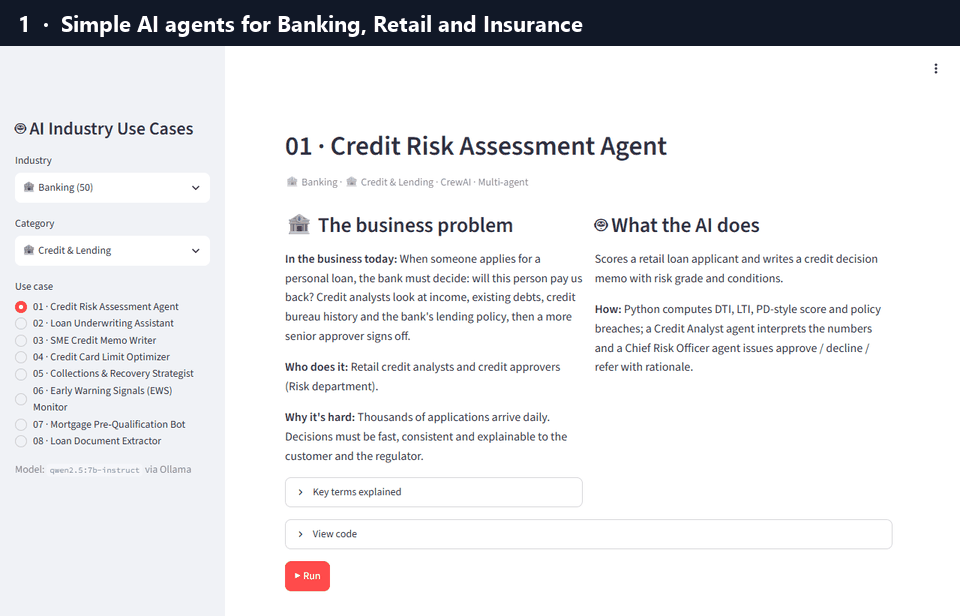
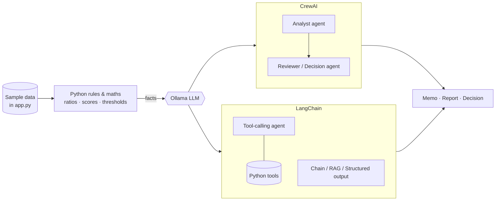

<div align="center">

# 🦙 Ollama AI Industry Use Cases

### Simple, local AI agents for real business problems, built with **Ollama**, **CrewAI** and **LangChain**

**[🌐 Interactive Explorer](https://rahulsing.github.io/Ollama-AI-Industry-Use-Cases/)** · [Industries](#-industries) · [Quick Start](#-quick-start) · [How It Works](#-how-it-works) · [Project Structure](#-project-structure) · [Contribute](#-contributing)


-000000)


[](LICENSE)



</div>

---

> **🌐 Browse without installing anything:** the [Interactive Explorer](https://rahulsing.github.io/Ollama-AI-Industry-Use-Cases/) lets you pick an industry,
> search every solution, read the business problem in plain English, and view the implementation code.

## 💡 What is this?

A hands-on collection of **56 runnable AI solutions across 3 industries**. Each one solves a real business
problem with a small, readable Python file.

- **100% local LLMs via [Ollama](https://ollama.com)**: no data leaves your machine. CrewAI telemetry and trace upload are switched off.
- **Two popular frameworks**: [CrewAI](https://github.com/crewAIInc/crewAI) for multi-agent crews and [LangChain](https://github.com/langchain-ai/langchain) for tool-calling agents, chains, extraction and RAG.
- **One file per use case** (`app.py`, ~60-120 lines) with realistic sample data, so each is easy to read, run and adapt.
- **Reliable pattern**: deterministic Python does the maths, rules and thresholds (auditable), and the LLM does the reasoning, explanation and writing.
- **Beginner-friendly**: every industry has a plain-English primer and glossary, and every use case explains the business problem first.

---

## 🏭 Industries

| # | Industry | What's inside | Use cases | Explore |
|---|---|---|---|---|
| 01 | 🏦 **[Banking](01_banking/)** | Retail, corporate and investment banking: Credit & Lending · Financial Crime & Compliance · Regulatory & Risk Reporting · Wealth & Investment Management · Retail Banking & Customer Experience · Treasury, Payments & Operations · Enterprise Analytics & Audit | **50** | [Use cases](01_banking/) · [Primer](01_banking/PRIMER.md) |
| 02 | 🛒 **[Retail](02_retail/)** | Stores, e-commerce and consumer brands: Supply Chain & Inventory · Customer Insight · Merchandising & Pricing | **3** | [Use cases](02_retail/) · [Primer](02_retail/PRIMER.md) |
| 03 | 🛡️ **[Insurance](03_insurance/)** | Property & casualty, motor and home insurers: Claims & Fraud · Policy & Customer Service · Underwriting & Pricing | **3** | [Use cases](03_insurance/) · [Primer](03_insurance/PRIMER.md) |

### 🏦 [Banking](01_banking/)

50 AI agents for credit, AML, regulatory reporting, wealth, customer service, treasury and audit.

- **🏦 Credit & Lending** (8): [Credit Risk Assessment Agent](01_banking/01_credit_risk_assessment/) · [Loan Underwriting Assistant](01_banking/02_loan_underwriting_assistant/) · [SME Credit Memo Writer](01_banking/03_sme_credit_memo_writer/) · [Credit Card Limit Optimizer](01_banking/04_credit_limit_optimizer/) · [Collections & Recovery Strategist](01_banking/05_collections_strategy_agent/) · [Early Warning Signals (EWS) Monitor](01_banking/06_early_warning_signals/) · [Mortgage Pre-Qualification Bot](01_banking/07_mortgage_prequalification_bot/) · [Loan Document Extractor](01_banking/08_loan_document_extractor/)
- **🕵️ Financial Crime & Compliance** (9): [AML Transaction Monitoring Agent](01_banking/09_aml_transaction_monitoring/) · [KYC Onboarding Verifier](01_banking/10_kyc_onboarding_verifier/) · [Sanctions Screening Assistant](01_banking/11_sanctions_screening_assistant/) · [SAR Narrative Generator](01_banking/12_sar_narrative_generator/) · [Card Fraud Detection Explainer](01_banking/13_card_fraud_explainer/) · [Trade-Based Money Laundering Detector](01_banking/14_tbml_detector/) · [Adverse Media Screening](01_banking/15_adverse_media_screening/) · [Customer Risk Rating (CRR)](01_banking/16_customer_risk_rating/) · [Money Mule Account Detector](01_banking/17_mule_account_detector/)
- **📜 Regulatory & Risk Reporting** (8): [Regulatory Reporting Agent](01_banking/18_regulatory_reporting_agent/) · [Basel III Capital Calculator Assistant](01_banking/19_basel_capital_calculator/) · [Liquidity LCR / NSFR Monitor](01_banking/20_liquidity_lcr_nsfr_monitor/) · [Regulatory Change Impact Analyzer](01_banking/21_regulatory_change_tracker/) · [Stress Testing Scenario Narrator](01_banking/22_stress_testing_narrator/) · [IFRS 9 ECL Calculator & Explainer](01_banking/23_ifrs9_ecl_calculator/) · [Bank Policy & Procedure Q&A (RAG)](01_banking/24_policy_qa_rag/) · [Model Risk Validation Assistant](01_banking/25_model_risk_validator/)
- **📈 Wealth & Investment Management** (7): [AI Wealth Advisor](01_banking/26_wealth_advisor_agent/) · [Portfolio Rebalancing Agent](01_banking/27_portfolio_rebalancer/) · [Investor Risk Profiling Agent](01_banking/28_risk_profiling_agent/) · [Market News Briefing for RMs](01_banking/29_market_news_summarizer/) · [Retirement Planning Assistant](01_banking/30_retirement_planner/) · [ESG Investment Screener](01_banking/31_esg_investment_screener/) · [Suitability & Mis-selling Checker](01_banking/32_suitability_checker/)
- **🙋 Retail Banking & Customer Experience** (8): [Banking Customer Support Agent](01_banking/33_customer_support_agent/) · [Complaint Classifier & Router](01_banking/34_complaint_classifier/) · [Personal Finance Coach](01_banking/35_personal_finance_coach/) · [Next Best Offer / Cross-sell](01_banking/36_next_best_offer/) · [Customer Churn Retention Agent](01_banking/37_churn_retention_agent/) · [Dispute & Chargeback Assistant](01_banking/38_dispute_chargeback_assistant/) · [Multilingual Banking FAQ (RAG)](01_banking/39_multilingual_faq_rag/) · [Call Center QA Analyzer](01_banking/40_call_center_qa/)
- **💱 Treasury, Payments & Operations** (6): [SWIFT Payment Repair Assistant](01_banking/41_swift_payment_validator/) · [Corporate Cash Flow Forecaster](01_banking/42_cash_flow_forecaster/) · [Reconciliation Exception Agent](01_banking/43_reconciliation_exception_agent/) · [Letter of Credit Document Checker](01_banking/44_trade_finance_lc_checker/) · [FX Hedging Advisor](01_banking/45_fx_hedging_advisor/) · [Invoice & Cheque Data Extractor](01_banking/46_invoice_cheque_extractor/)
- **🏢 Enterprise Analytics & Audit** (4): [Financial Statement Analyzer](01_banking/47_financial_statement_analyzer/) · [Earnings Call Analyzer](01_banking/48_earnings_call_analyzer/) · [Internal Audit Assistant](01_banking/49_internal_audit_assistant/) · [Operational Risk Incident Analyzer](01_banking/50_operational_risk_analyzer/)

### 🛒 [Retail](02_retail/)

AI agents for forecasting, pricing and customer insight in stores and e-commerce.

- **📦 Supply Chain & Inventory** (1): [Demand Forecasting & Replenishment Agent](02_retail/01_demand_forecasting_agent/)
- **🙋 Customer Insight** (1): [Product Review Analyzer](02_retail/02_product_review_analyzer/)
- **🏷️ Merchandising & Pricing** (1): [Dynamic Pricing Advisor](02_retail/03_dynamic_pricing_advisor/)

### 🛡️ [Insurance](03_insurance/)

AI agents for claims handling, fraud detection, coverage questions and pricing.

- **🧾 Claims & Fraud** (1): [Claims Triage & Fraud Detection](03_insurance/01_claims_triage_fraud/)
- **🙋 Policy & Customer Service** (1): [Policy Coverage Q&A (RAG)](03_insurance/02_policy_coverage_qa/)
- **📝 Underwriting & Pricing** (1): [Motor Insurance Quote Agent](03_insurance/03_motor_quote_agent/)

---

## 🚀 Quick Start

```bash
# 1. Install Ollama (https://ollama.com/download) and pull a model
ollama pull qwen2.5:7b-instruct        # default: strong tool calling at 7B
ollama pull nomic-embed-text           # embeddings for the RAG use cases

# 2. Clone and install (Python 3.10 - 3.13)
git clone https://github.com/rahulsing/Ollama-AI-Industry-Use-Cases.git
cd Ollama-AI-Industry-Use-Cases
python -m venv .venv && source .venv/bin/activate      # Windows: .venv\Scripts\activate
pip install -r requirements.txt
cp .env.example .env                                   # optional: change model / Ollama URL

# 3. Run any use case: python <industry>/<use-case>/app.py
python 01_banking/01_credit_risk_assessment/app.py

# 4. Or use the web UI: pick an industry and use case, then click Run
streamlit run ui.py
```

### 🧠 Model recommendations

| Model | Size | Notes |
|-------|------|-------|
| `qwen2.5:7b-instruct` | 4.7 GB | **Default.** Reliable tool calling & JSON output on a laptop |
| `llama3.1:8b` | 4.9 GB | Good all-rounder |
| `qwen2.5:14b` / `gemma3:27b` | 9-17 GB | Better reasoning for the CrewAI report writers |
| `gpt-oss:20b`, `qwen2.5:72b` | 13-47 GB | Best quality if you have the GPU memory |

Switch with `OLLAMA_MODEL=llama3.1:8b python ...` or in `.env`. Set `CREW_VERBOSE=true` to watch CrewAI agents think.

---

## ⚙️ How It Works



| Pattern | When to use | Examples |
|---------|-------------|----------|
| **Multi-agent (CrewAI)** | Analysis + review + write-up, like a committee | [Credit risk](01_banking/01_credit_risk_assessment/), [AML](01_banking/09_aml_transaction_monitoring/), [Claims fraud](03_insurance/01_claims_triage_fraud/) |
| **Tool-calling agent (LangChain)** | Questions that need live calculations or system lookups | [Loan underwriting](01_banking/02_loan_underwriting_assistant/), [Replenishment](02_retail/01_demand_forecasting_agent/), [Motor quote](03_insurance/03_motor_quote_agent/) |
| **Chain (LangChain)** | Python decides, the LLM explains | [Card fraud](01_banking/13_card_fraud_explainer/), [Liquidity](01_banking/20_liquidity_lcr_nsfr_monitor/) |
| **Structured extraction** | Unstructured text to a validated schema | [Loan documents](01_banking/08_loan_document_extractor/), [Product reviews](02_retail/02_product_review_analyzer/) |
| **RAG** | Q&A grounded in policies or documents | [Bank policy Q&A](01_banking/24_policy_qa_rag/), [Insurance coverage Q&A](03_insurance/02_policy_coverage_qa/) |

### Framework comparison

| | CrewAI | LangChain |
|---|---|---|
| Best for | Role-based collaboration, long-form reports | Tools, chains, extraction, RAG, chatbots |
| Multi-agent | ✅ native (crews, tasks, context) | ✅ via LangGraph |
| Local LLM (Ollama) | ✅ `LLM(model="ollama/...")` | ✅ `ChatOllama` |
| Used here for | 24 use cases | 32 use cases |

---

## 📁 Project Structure

```
├── 01_banking/                 # one numbered folder per industry
│   ├── README.md               # industry catalog (generated)
│   ├── PRIMER.md               # how the industry works + glossary (generated)
│   ├── catalog.py              # use-case list for this industry
│   ├── business.py             # plain-English business context + glossary
│   └── 01_credit_risk_assessment/
│       ├── app.py              # self-contained runnable use case
│       └── README.md
├── 02_retail/  03_insurance/   # same layout
├── common/                     # shared Ollama helpers (LangChain + CrewAI) and RAG retriever
├── scripts/build_docs.py       # regenerates every README and primer
├── ui.py                       # optional Streamlit front end
├── docs/                       # GitHub Pages: index.html (interactive explorer, generated) + demo.gif
├── requirements.txt
└── .env.example
```

---

## 🤝 Contributing

**Add a use case:** copy a folder with the same pattern into the industry folder, keep it self-contained (one
`app.py`, sample data inline, Ollama only), add it to that industry's `catalog.py` and `business.py`, then run
`python scripts/build_docs.py`.

**Add an industry:** create `04_<industry>/` with a `catalog.py` and `business.py` (copy `02_retail/` as a template)
and at least one use case. The README, primer and UI pick it up automatically.

Ideas welcome: healthcare, telecom, energy, manufacturing, public sector...

---

## 📄 License

[MIT](LICENSE) © 2026 DataTechBridge. Free to use, modify and share, including commercially.

---

## ⚠️ Disclaimer

All data, people, companies, policies and regulations in this repo are **fictional sample data** for education.
Calculations are simplified illustrations of industry concepts and are **not** production models or professional
(financial, insurance or legal) advice. Validate any model and keep a human in the loop before real use.

<div align="center">

⭐ **If this helps you, star the repo!** ⭐

</div>
